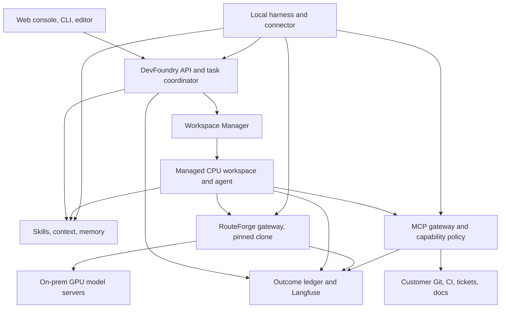
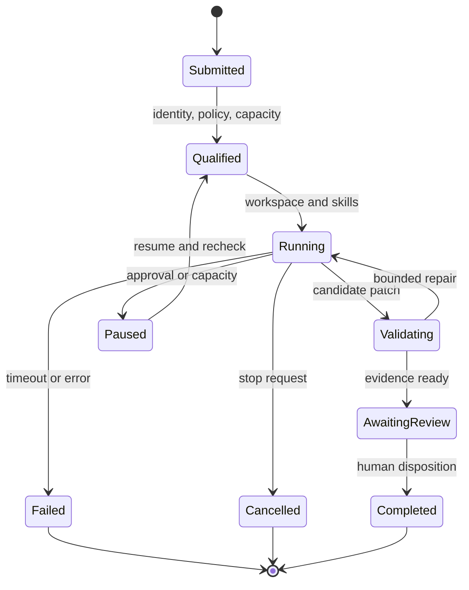

# DevFoundry: on-premises software factory architecture and implementation plan

Design date: 6 October 2026. Revised: **7 October 2026**. Product name: **DevFoundry**. This is a proposed architecture, not a claim that the application has been implemented or qualified. DevFoundry is a separate application that integrates a pinned, unmodified clone of [RouteForge](https://github.com/mani-mal/routeForge) as its model gateway. RouteForge model routing and Langfuse evaluation collection are existing capabilities reported by the owner. The supplied repository returned 404 through the current GitHub connection, so its source, license and exact interfaces remain unverified.

## 1. Product decision

Build **DevFoundry** as an on-premises engineering platform with three execution modes: a developer's local harness, a remotely attached development workspace, and delegated background tasks. Integrate RouteForge as a separately versioned model gateway using its existing supported APIs and configuration. Develop DevFoundry's task, policy, workspace, skills, context and review functions in its own codebase. A customer can start on one appliance and later separate the control services, CPU workspaces, and GPU inference servers without changing the task and policy contracts.

Sell a qualified installation, customer-owned integrations, controlled agent execution, evidence for code review, and ongoing operation. A collection of containers around a model endpoint is insufficient to provide that product. The differentiator is consistent operation across local and server execution, with measured quality, resource admission, and an auditable path from request to accepted change.

Keep the first release focused on software engineering. GPUPerf can later provide a read-only infrastructure inventory and health integration. Infrastructure remediation, production deployment, and universal enterprise assistants would materially expand the initial scope.

## 2. DevFoundry components and first-release scope

Start with five to ten useful engineering skills and one workflow: **request -> isolated patch -> clean validation -> review packet -> optional draft PR**. Build the lifecycle, access boundaries and evidence needed to run this workflow reliably on customer-owned hardware. Measure performance and quality with the selected harness, local models and actual hardware profiles.

| Component | First release | Later, when needed | Ownership |
|---|---|---|---|
| **Model gateway** | Pinned RouteForge deployment, supported model catalog/routes, existing auth/configuration and Langfuse integration | Additional capabilities exposed by an independently qualified upstream RouteForge release | Clone [mani-mal/routeForge](https://github.com/mani-mal/routeForge) unchanged; DevFoundry owns integration and task admission |
| **MCP gateway** | ContextForge registry/proxy; approved tools, selected schemas, scopes, timeouts, rate limits and audit events | CLI batching, code-mode filtering and a richer operator playground after measuring tool overhead | Integrate ContextForge; build DevFoundry policy mapping and `devfoundry tools` CLI |
| **Workspaces and agents** | One managed OpenCode adapter, isolated worktrees/CPU containers, reproducible images, resource limits, clean tests and editor attachment where needed | Additional harnesses, warm pools, snapshots, browser visual validation and cross-repo environments | Build DevFoundry workspace lifecycle and adapter contracts |
| **Skills** | Small Git-backed catalog; versions/digests; install/list/update CLI; project defaults; lint, representative tasks, compatibility checks and human promotion | Customer packs and evaluated improvement proposals driven by failures/review feedback | Build DevFoundry lifecycle on the Agent Skills format |
| **Context and memory** | ACL-aware repo/document retrieval; PostgreSQL node/edge tables; private local history; approved project memory | pgvector, richer graph expansion or Apache AGE when measured tasks justify them | Build DevFoundry connectors, provenance and access filtering |
| **Developer interface** | CLI and a small web task/review surface, auth, evidence and appliance health | Scheduled engineering jobs, API clients and optional chat integrations | Independent DevFoundry UI/API; link to RouteForge's existing gateway administration if useful |
| **Quality and feedback** | Existing RouteForge/Langfuse collection plus a DevFoundry task-outcome ledger and clean validation results | Offline route/skill recommendations, applied through supported configuration or reviewed releases | Retain the gateway integration; build DevFoundry task/evidence records |

Keep global workspace fleets, mobile simulators, large skill marketplaces, employee personas, universal business assistants, privileged Docker-in-Docker and multi-agent orchestration outside the initial release. Temporal, Kubernetes and extra telemetry services are optional integrations with explicit adoption triggers in section 5.

## 3. Logical architecture



All nodes above can be inside the customer's network. Local execution refers to the harness and worktree, not necessarily model inference. Remote execution means a customer-owned server, not a required public cloud service.

DevFoundry and RouteForge can share an appliance while remaining separate services and codebases. The DevFoundry application connects through the gateway's supported API/configuration; its installer records the RouteForge source and image revisions.

Four deployment planes:

1. **Experience plane:** browser console, CLI, editor attachment, task and review views.
2. **Control plane:** identity, task state, workflow history, policy, registries, quotas, scheduling, and release management.
3. **Execution plane:** local connectors, isolated CPU workspaces, code-mode subprocesses, builds, test runners, and integration services.
4. **Inference plane:** resident model servers on NVIDIA GPUs behind RouteForge. Models remain separate from agent lifecycle management.

One deployment may collocate these planes. Their APIs and identities should remain separate even on Spark.

## 4. Developer experience and ownership

| Mode | Laptop contains | Server contains | Suitable work | Enforcement limit |
|---|---|---|---|---|
| Local harness | OpenCode/Pi, worktree, local session history, installed skill copies | Shared models, MCP tools, context and skill sources, optional trace ingestion | Interactive development with existing tools | Unmanaged shell/network access can bypass DevFoundry gateways |
| Attached remote workspace | Editor/terminal frontend and connection credentials | Worktree, harness, session files, builds, tests, installed skills | Consistent team environments and heavier builds | Stronger enforcement when workspace networking and identity are managed |
| Background task | Browser/CLI request and review interface | Agent, isolated worktree, durable task state, evidence and artifacts | Bug fixes, migrations, CI repair, approved maintenance | Managed worker policy applies; human review remains explicit |

The shared registry is the authority for a published skill version; installation produces a local or remote copy. The Context Service retrieves permitted snippets on demand. Personal memory remains private by default. Do not synchronize a developer's complete home directory, shell configuration, `.env` files, or SSH keys.

Moving from local to remote creates a new attempt from an approved checkpoint: base commit, patch, selected memory, skill digests, and task description. It is not live migration of an arbitrary harness process or its GPU KV cache. Harness-specific conversation export is optional and separately qualified. A task can resume after a restart without promising identical model output.

The local connector needs an explicit opt-in for workspace/session uploads, per-project exclusions, and a preview of the material to be sent. Managed wrappers provide supported integration; bring-your-own harnesses have declared limitations rather than a blanket compatibility claim.

## 5. Component selection and build-versus-integrate choices

### 5.1 Smallest useful stack

Use open-source application components where they fit. **Do not install every option in this section.** The first release needs a DevFoundry API/UI, one worker type, RouteForge, ContextForge, PostgreSQL, one resident model endpoint, and an appropriate telemetry preset. Skills/context/memory/task coordination are modules of the DevFoundry service initially, not separate microservices.

The links in the license column point to upstream license files inspected on **7 October 2026**. These are repository-level classifications, not a complete license audit of dependencies, images, model weights or older tags. Pin and audit the exact releases before redistribution.

| Component | Git repository | License and type | First-release choice / work to build |
|---|---|---|---|
| Model gateway | [mani-mal/routeForge](https://github.com/mani-mal/routeForge) | **Unverified**; repository/license inspection was blocked by 404 through the current connection | Clone and deploy a pinned revision unchanged. Use existing APIs/configuration; place any needed integration adapter in DevFoundry |
| Model serving | [vllm-project/vllm](https://github.com/vllm-project/vllm) | [Apache-2.0, permissive](https://github.com/vllm-project/vllm/blob/main/LICENSE) | Default candidate; qualify the exact model/hardware pair. Keep inference separate from CPU workers |
| MCP gateway | [IBM/mcp-context-forge](https://github.com/IBM/mcp-context-forge) | [Apache-2.0, permissive](https://github.com/IBM/mcp-context-forge/blob/main/LICENSE) | Integrate its registry/proxy. Build DevFoundry scope mapping and small tool-discovery CLI |
| Primary local/remote harness | [anomalyco/opencode](https://github.com/anomalyco/opencode) | [MIT, permissive](https://github.com/anomalyco/opencode/blob/dev/LICENSE) | First supported managed adapter. Qualify headless server, MCP, events, interruption and model compatibility |
| Additional local harness | [earendil-works/pi](https://github.com/earendil-works/pi) | [MIT, permissive](https://github.com/earendil-works/pi/blob/main/LICENSE) | Keep existing local usage; qualify a separate remote adapter later. Old `badlogic/pi-mono` links redirect here |
| Metadata, task state, memory and graph | [postgres/postgres](https://github.com/postgres/postgres) | [PostgreSQL license, permissive](https://github.com/postgres/postgres/blob/master/COPYRIGHT) | One server, separate service databases/roles. DevFoundry node/edge tables, full-text search, task leases and outcome ledger |
| Vector retrieval | [pgvector/pgvector](https://github.com/pgvector/pgvector) | [PostgreSQL license, permissive](https://github.com/pgvector/pgvector/blob/master/LICENSE) | Add when semantic retrieval helps. It supplies vector search, not graph traversal; record embedding model/version |
| Code parsing | [tree-sitter/tree-sitter](https://github.com/tree-sitter/tree-sitter) | [MIT, permissive](https://github.com/tree-sitter/tree-sitter/blob/master/LICENSE) | Extract symbols/relationships for supported languages. Check each language grammar's separate license |
| Skill format and validation reference | [agentskills/agentskills](https://github.com/agentskills/agentskills) | [Apache-2.0, permissive](https://github.com/agentskills/agentskills/blob/main/LICENSE) | Git-backed skill packs, install CLI, tests, version promotion and capability manifest. Customer skills keep their own licenses |
| Linux container engine | [moby/moby](https://github.com/moby/moby) | [Apache-2.0, permissive](https://github.com/moby/moby/blob/master/LICENSE) | Docker Engine/Moby foundation for qualified Linux deployments; isolated workspaces. Docker Desktop is a separate product, not required |
| Single-host deployment | [docker/compose](https://github.com/docker/compose) | [Apache-2.0, permissive](https://github.com/docker/compose/blob/main/LICENSE) | Appliance service deployment; worker lifecycle through a trusted manager. Do not mount the host Docker socket in agent workspaces |
| GPU container access | [NVIDIA/nvidia-container-toolkit](https://github.com/NVIDIA/nvidia-container-toolkit) | [Apache-2.0, permissive](https://github.com/NVIDIA/nvidia-container-toolkit/blob/main/LICENSE) | Model-service GPU access only; qualify against DGX OS/driver ownership and architecture |
| Trace/evaluation UI | [langfuse/langfuse](https://github.com/langfuse/langfuse) | [MIT core; commercial EE exceptions](https://github.com/langfuse/langfuse/blob/main/LICENSE) | Reuse existing integration, use OSS features only. Keep accepted-task outcomes in DevFoundry rather than relying on traces alone |
| Version control executable | [git/git](https://github.com/git/git) | [GPL-2.0, copyleft; see file-specific exceptions](https://github.com/git/git/blob/master/COPYING) | Invoke Git for task worktrees/branches; preserve its notices and required source availability when bundling it |

ContextForge already provides governance and proxy functions. Integrate it alongside RouteForge. Build DevFoundry's identities/scopes, worker lifecycle, context connectors, skill promotion, review evidence, hardware presets and installer/restore procedures in a separate codebase. RouteForge remains a versioned dependency with its own API, configuration, persistence and update lifecycle. Integration adapters may translate supported interfaces or correlate events; they do not replace the model router or require edits to its source.

### 5.2 Optional integrations, with explicit adoption triggers

| Component | Git repository | License and type | Adopt when |
|---|---|---|---|
| Alternative serving backend | [ggml-org/llama.cpp](https://github.com/ggml-org/llama.cpp) | [MIT, permissive](https://github.com/ggml-org/llama.cpp/blob/master/LICENSE) | A supported quantized model fits a hardware profile better; qualify API/tool behavior independently |
| Agent SDK/runtime alternative | [OpenHands/software-agent-sdk](https://github.com/OpenHands/software-agent-sdk) | [MIT, permissive](https://github.com/OpenHands/software-agent-sdk/blob/main/LICENSE) | Its worker API reduces implementation effort or passes required tasks better than the first OpenCode adapter |
| Larger agent console | [OpenHands/OpenHands](https://github.com/OpenHands/OpenHands) | [MIT at the inspected current revision](https://github.com/OpenHands/OpenHands/blob/main/LICENSE) | Agent Canvas saves substantial UI/backend work. Evaluate it before building a large console; avoid coupling the MVP to two consoles |
| Durable workflow engine | [temporalio/temporal](https://github.com/temporalio/temporal) | [MIT, permissive](https://github.com/temporalio/temporal/blob/main/LICENSE) | Long-lived workflows, many external waits, complex compensations or distributed recovery exceed the bounded worker design |
| Property graph extension | [apache/age](https://github.com/apache/age) | [Apache-2.0, permissive](https://github.com/apache/age/blob/master/LICENSE) | Measured queries justify Cypher/property-graph capabilities. Qualify its release against the selected PostgreSQL major version |
| Identity provider | [keycloak/keycloak](https://github.com/keycloak/keycloak) | [Apache-2.0, permissive](https://github.com/keycloak/keycloak/blob/main/LICENSE.txt) | Multi-user deployment has no suitable customer OIDC provider; authentication itself remains required |
| Secrets service | [openbao/openbao](https://github.com/openbao/openbao) | [MPL-2.0, file-level copyleft](https://github.com/openbao/openbao/blob/main/LICENSE) | Shared deployments need centralized rotation and dynamic credentials and have no customer secrets service |
| Telemetry collector | [open-telemetry/opentelemetry-collector](https://github.com/open-telemetry/opentelemetry-collector) | [Apache-2.0, permissive](https://github.com/open-telemetry/opentelemetry-collector/blob/main/LICENSE) | A common export/processing service is useful. Emit structured events initially; add a collector only as needed |
| Metrics server | [prometheus/prometheus](https://github.com/prometheus/prometheus) | [Apache-2.0, permissive](https://github.com/prometheus/prometheus/blob/main/LICENSE) | Historical operational metrics/alerts are required; simple health/resource views can come first |
| Metrics dashboards | [grafana/grafana](https://github.com/grafana/grafana) | [AGPLv3, network copyleft](https://github.com/grafana/grafana/blob/main/LICENSE) | Customer wants richer dashboards and its packaging obligations are accepted. OSS Grafana is optional; Enterprise plugins/features are separate |
| GPU metrics exporter | [NVIDIA/dcgm-exporter](https://github.com/NVIDIA/dcgm-exporter) | [Apache-2.0 for exporter source](https://github.com/NVIDIA/dcgm-exporter/blob/main/LICENSE) | DCGM and the chosen GPU/platform are supported. Inspect bundled DCGM/driver terms separately; use qualified fallback collectors on Spark |
| Stronger container isolation | [google/gvisor](https://github.com/google/gvisor) | [Apache-2.0, permissive](https://github.com/google/gvisor/blob/master/LICENSE) | Threat model needs it and builds/tests work with it; hostile tenants may require VM/node isolation instead |
| Cluster scheduler | [kubernetes/kubernetes](https://github.com/kubernetes/kubernetes) | [Apache-2.0, permissive](https://github.com/kubernetes/kubernetes/blob/master/LICENSE) | Multiple worker/GPU nodes, HA or existing customer Kubernetes justify cluster operations |
| Cluster packaging | [helm/helm](https://github.com/helm/helm) | [Apache-2.0, permissive](https://github.com/helm/helm/blob/main/LICENSE) | Shipping the Kubernetes profile |
| GPU cluster management | [NVIDIA/gpu-operator](https://github.com/NVIDIA/gpu-operator) | [Apache-2.0 for operator source](https://github.com/NVIDIA/gpu-operator/blob/main/LICENSE) | Customer cluster supports its GPU/driver lifecycle; managed NVIDIA components have their own terms |
| Workload identity specification | [spiffe/spiffe](https://github.com/spiffe/spiffe) | [Apache-2.0, permissive](https://github.com/spiffe/spiffe/blob/main/LICENSE) | Enterprise workload identity federation is required |
| Workload identity implementation | [spiffe/spire](https://github.com/spiffe/spire) | [Apache-2.0, permissive](https://github.com/spiffe/spire/blob/main/LICENSE) | Customer uses SPIFFE/SPIRE; task-scoped credentials are still required without it |

The current OpenHands Agent Canvas and SDK have separate repositories and should not be confused with its commercial cloud/enterprise services or older releases. Qualify the selected tag and build; a current top-level MIT file does not settle the terms of every historical release or dependency.

### 5.3 Full Langfuse dependencies and artifact storage

The full self-hosted Langfuse service requires more than PostgreSQL. Its upstream Compose file currently includes ClickHouse, Redis 7 and MinIO [C11]. For a controlled OSS appliance, evaluate the following substitutions rather than shipping that example unchanged:

| Component | Git repository | License and type | Packaging decision |
|---|---|---|---|
| Langfuse analytical database | [ClickHouse/ClickHouse](https://github.com/ClickHouse/ClickHouse) | [Apache-2.0, permissive](https://github.com/ClickHouse/ClickHouse/blob/master/LICENSE) | Required by Full telemetry; bounded retention/storage |
| Langfuse queue/cache candidate | [valkey-io/valkey](https://github.com/valkey-io/valkey) | [BSD-3-Clause, permissive](https://github.com/valkey-io/valkey/blob/unstable/COPYING) | Qualify as a Redis-compatible substitution for the pinned Langfuse/BullMQ release; compatibility is not established by this design |
| Local S3-compatible storage candidate | [seaweedfs/seaweedfs](https://github.com/seaweedfs/seaweedfs) | [Apache-2.0, permissive](https://github.com/seaweedfs/seaweedfs/blob/master/LICENSE) | Qualify OSS S3 behavior for Langfuse ingestion/media and backup/restore; customer-provided S3-compatible storage is another option |

DevFoundry review artifacts can initially use a protected filesystem volume with manifest digests, authenticated downloads and backups. That does **not** eliminate Langfuse's S3 requirement. Use one qualified S3 service for both only if their access/retention policies remain separate. Do not add an object store solely for a few patch/test files in the Compact preset.

**Compact:** DevFoundry task/outcome records and bounded local events; optional forwarding/spooling to an existing customer-owned Langfuse instance. Without that instance, the full Langfuse dashboard/evaluation service is not available. **Full:** Langfuse web/worker and its database/queue/blob dependencies. Existing evaluation collection must be verified in either preset; Compact is not feature-equivalent to Full. Runtime egress is not necessary in either customer-owned deployment.

### 5.4 Workflow and licensing decisions

For the first release, use **PostgreSQL-backed durable jobs plus one bounded worker type**, not an in-memory web-server background queue. Persist phase, attempt, checkpoint, cancellation and review status. Use transactional job claiming, leases/heartbeats, attempt fencing, an outbox and idempotency/reconciliation for external writes. Restart recovery reclaims expired work and resumes from a supported checkpoint. Use Temporal when implementing equivalent advanced recovery behavior becomes more work than operating it; if adopted, ship supported persistence rather than its development server.

Prefer MIT/Apache/PostgreSQL/BSD foundations for custom integration. MPL/GPL/AGPL are also open-source licenses, not automatic exclusions from a commercial product. Their source/distribution or network-use requirements need to be addressed for the exact bundle. Preserve upstream license/NOTICE files and make required covered source available; keep a release-specific SBOM/license manifest. Do not relabel Langfuse EE as OSS or assume paid SSO/SCIM/audit features become available by placing Keycloak in front of it. DevFoundry authentication, retention and its own audit ledger must work with the selected OSS integrations.

The selected third-party application foundations have **open-source options**. RouteForge's license remains unverified and must be recorded before describing the complete application bundle as all open source. The NVIDIA appliance also includes CUDA, some driver/runtime components and optional vendor services with separate terms [H6]. Model weights/tokenizers, embeddings and customer skill content have independent licenses. Do not preinstall/redistribute a model merely because its serving engine is Apache or MIT licensed. Apache-2.0 is a reasonable proposed license for newly authored DevFoundry code, subject to the owner's decision; the separately cloned RouteForge retains its existing license and notices.

## 6. Integration with the unmodified RouteForge model gateway

**Source:** [https://github.com/mani-mal/routeForge](https://github.com/mani-mal/routeForge). Clone URL: `https://github.com/mani-mal/routeForge.git`. Deploy a pinned commit/image as a separate gateway service. DevFoundry uses its supported inference API, authentication and configuration; gateway source changes are outside this application plan. Verify the actual API contract after authorized repository access is available rather than inventing endpoints or assuming every desired feature already exists.

| RouteForge owns | DevFoundry owns |
|---|---|
| Existing model routing, serving-endpoint connections and gateway authentication/configuration | Developer identity, project/task authorization and gateway credential mapping |
| Existing streaming/tool-call behavior and available gateway request limits | Task admission, CPU workspace budgets, cancellation orchestration and adapter conformance |
| Existing Langfuse collection/integration | Task phases, attempt IDs, accepted outcomes, evidence and trace correlation |
| Existing gateway administration and release behavior | Product UI, deployment profiles, dependency pinning and integration/restore checks |

Configure each supported harness/worker to call the approved RouteForge endpoint with scoped credentials using the gateway's actual supported format. Direct API integration is the default. Add a small DevFoundry adapter only for a concrete gap such as credential mapping or trace correlation. It remains outside RouteForge, preserves streaming/cancellation semantics and does not become a second routing engine. If a required capability cannot be provided through existing configuration or a compatible external adapter, narrow the supported feature set or qualify an upstream release.

Keep the task attribution envelope in DevFoundry: `tenant_id`, `project_id`, `user_id`, `task_id`, `attempt_id`, `phase` and `trace_id`. Derive protected identities from authenticated claims. Pass correlation fields to RouteForge only through metadata/headers its current API accepts. Where propagation is unavailable, retain an external mapping of task/attempt/request identifiers in the DevFoundry outcome ledger; exact Langfuse linkage is available only when a stable correlation identifier is exposed. Do not claim per-task gateway traces from timestamp matching alone.

DevFoundry's deployment/model inventory records model/tokenizer and serving-image digests, gateway aliases/configuration version, API/tool-call capabilities, GPU requirements, supported context, quantization, qualified concurrency, health and measured task quality. Map task phases to existing supported model aliases/routes. Use RouteForge's routing and fallback configuration wherever available. Enforce residency and project eligibility in DevFoundry authorization, supported gateway configuration and network controls, not by adding routing code to the clone.

The DevFoundry scheduler admits managed tasks before their agents start. Qualify RouteForge's existing request-limit behavior and serving capacity; use an external boundary control only where a verified gap requires it. Local direct-to-gateway sessions have the gateway's actual controls, not every DevFoundry worker constraint. Avoid a global lock that prevents continuous batching. Keep model services resident and agents on CPU resources rather than creating a vLLM instance for every agent.

Start with explicit phase/model mappings and benchmark-qualified fallback. Offline task outcomes can later produce configuration recommendations for review. RouteLLM and FrugalGPT motivate workload-sensitive model selection, but their API-cost findings do not establish savings for owned GPUs [P5, P6]. Distinguish hardware ownership cost, opportunity cost, energy and loading delay. Keep cross-project semantic caching disabled unless the selected gateway/configuration can enforce the required permission/version boundaries. KV and prompt caches remain transient inference mechanisms, not durable developer memory.

## 7. MCP gateway and tool economics

Create a **registry/control plane** for ownership, schema versions, enablement, and permissions, and a **gateway/data plane** for execution. Imported tools begin disabled. An owner approves an immutable version before it is exposed. Support HTTP/Streamable HTTP and required compatibility adapters only after conformance tests; protocol support is not identical across servers.

Suggested product commands: `devfoundry tools search`, `devfoundry tools describe`, and `devfoundry tools call`. These are proposed commands, not an installed CLI. Tool discovery returns a small catalog; exact schema and output are loaded only for selected tools. An optional code-mode runner can batch calls and filter large responses before returning a summary. This is an optimization with its own security boundary, not a license for arbitrary Python to use administrator credentials.

The runner receives a task-scoped capability set, temporary credentials, allowed endpoints, output limits, timeout and a file namespace. Results include status, provenance, pagination, and artifact references. Return bounded summaries with links to full results, not silently truncated evidence.

Initial adapters: customer Git hosting, CI read/status, ticket search, documentation search, artifact inspection, and approved sandbox builds. Add write APIs individually. Side effects carry an idempotency key and required action policy. Git operations publish a branch/PR only within the configured repo; merge and deployment remain distinct permissions.

The MCP security guidance explicitly rejects unsafe token passthrough and covers confused-deputy concerns [C6]. Validate downstream audiences and exchange credentials as needed. Network allowlists must be narrow enough to reach customer tools while preventing arbitrary internal network probing. Respect a gateway's private-network protection rather than turning it off globally.

## 8. Workspace and harness adapter

The Workspace Manager supports `prepare`, `attach`, `checkpoint`, `interrupt`, `collect_artifacts`, and `destroy`. Each managed task uses a unique worktree or clone, immutable base commit, writable task volume, read-only source caches, and an explicit workspace lease. Concurrent tasks never edit the same checkout.

The Harness Adapter supports `start`, `send_input`, `stream_events`, `request_cancel`, `checkpoint`, and `result`. Its conformance suite checks an actual file edit, command, tool call, interruption, restart, streaming result, and stable task attribution. OpenCode documents ACP integration [C7]. Pi requires its own qualified adapter [C8]; do not assume every harness implements ACP, native MCP, or identical session serialization.

Use **OpenCode as the first managed adapter**, matching the owner's existing harness workflow. Its official headless server API provides sessions, asynchronous prompts, events and interruption [C12]. Keep that server private inside a managed workspace, behind DevFoundry authorization rather than exposing its basic-auth interface as the complete multi-user platform. Qualify restart/checkpoint semantics and RouteForge tool-call compatibility. Pi remains supported for existing local usage; a remote Pi adapter and OpenHands SDK are later choices. Keep task state independent of the selected harness. A single agent is sufficient initially; multi-agent execution is optional and bounded by resource and token budgets.

For trusted single-user appliances, hardened rootless containers provide a practical baseline. For stronger managed isolation, qualify gVisor or VM/microVM runtimes on the actual architecture [C9]. Containers alone are not a sufficient hostile-tenant guarantee. Enterprise isolation can require dedicated worker VMs/nodes and separate inference endpoints. CPU workspaces normally have no GPU device mounts and never receive the host Docker socket.

Warm images and caches are useful, but warm pools compete with inference and other builds on small machines. Start with demand-created workspaces on Spark. Use production-like dependency snapshots and language-specific images; add cross-repository environments only when a task requires them.

## 9. Skills, context and memory

### Skills

Treat a skill as a versioned engineering procedure: instructions, optional scripts, required capabilities, input/output contract, tests, owner, approved model profiles, and digest. Add a permissions manifest beside the standard skill files. Validate syntax, script dependencies, secret handling, declared permissions and regression tasks before promotion.

Lifecycle: `draft -> linted -> sandbox-tested -> evaluated -> approved -> published -> deprecated`. Roll back by digest. Automatically proposed updates never overwrite approved releases. Core packs can cover repo orientation, patch generation, regression testing, security review, CI repair, and maintenance. Domain packs are customer-controlled.

### Context

Start with repository search, code symbol/dependency extraction, document ingestion, and issue/PR linking. Use PostgreSQL full-text search and adjacency tables for `service -> repo -> owner -> dependency -> document -> issue` relationships. Add pgvector when semantic retrieval improves representative tasks. Add a separate graph database only after queries, scale, and maintenance requirements justify it.

**Yes, PostgreSQL is sufficient for this Context Graph; Neo4j is not required.** A context graph is the application's connected metadata and retrieval behavior, not a requirement to run a particular graph database. Use ordinary node/edge tables first. PostgreSQL supports recursive CTE traversal and cycle detection [C13]. If actual property-graph/Cypher requirements emerge, Apache AGE supplies graph functionality inside PostgreSQL [C14]. That extension is optional and is not a drop-in promise of compatibility with every Neo4j API or query.

| Need | Initial PostgreSQL implementation |
|---|---|
| Entities and provenance | `context_nodes`: IDs, tenant/project/repo scope, kind, source revision, owner/ACL reference and JSONB metadata |
| Relationships | `context_edges`: source/destination IDs, relation type, scope, source revision and provenance; enforce endpoint references and scope boundaries |
| Source snippets | `context_chunks`: file/document location, revision, text, full-text index and optional embedding/model version |
| Dependency or ownership questions | Indexed SQL joins or bounded recursive CTEs; authorize starting node, edges and destination nodes at every hop |
| Semantic lookup | pgvector plus authorization-aware retrieval; an approved embedding model is a separate inference/licensing choice |
| Index freshness | Incremental Git revision ingestion, changed-file updates, deletion/revocation processing and visible indexing status |

Index outgoing and incoming edges by scope, endpoint and relation; keep provenance/ACL lookup efficient. Start graph expansion at one or two hops with configurable result/time limits and cycle protection. Measure representative queries and grounded task outcomes before adding an extension. A full repository text index is more useful initially than an expensive inferred graph of every possible code relationship.

One PostgreSQL server can host separate DevFoundry, ContextForge and Langfuse databases with independent roles, backups and migrations. Use application authorization and appropriately configured row-level security as defense in depth; do not let a table-owner/superuser role silently bypass the intended policy. Using one server reduces appliance services but shares capacity and failure risk. Apache AGE adds extension/version/backup qualification, not a second server. Its release compatibility is specific to the PostgreSQL major version [C15].

Every chunk/edge carries source ID, revision, ACL, timestamp, parser version and indexing status. Authorize before retrieval and before graph traversal; never retrieve broad results and merely redact the final answer. Apply access filters to vector search, textual search, cache and graph expansion. Revoked access must invalidate cached results and indexes within a defined operational target.

Repoformer motivates selective retrieval but evaluates repository-level completion rather than a complete factory [P7]. Retrieve according to a phase's information needs and measure groundedness, latency and task success rather than simply increasing context volume.

### Memory

Separate personal preferences, project conventions, task summaries and approved incident lessons. Each record has owner, scope, provenance, revision, TTL, confidence and promotion status. Candidate memory derived from tool output is untrusted. Store useful facts only after validation or explicit acceptance; do not convert arbitrary instructions in a README/tool result into governing policy.

Local sessions can retain private history. Shared project memory is an approved export, not a default upload of all developer state. Remote task state resides in customer-owned persistence. MemGPT is relevant to tiered memory; persistence alone does not establish useful or safe memory [P8].

## 10. Managed task lifecycle and recovery



All terminal outcomes are durable and include why they occurred. Tool intent is recorded before execution; the completion is recorded afterwards. Read-only calls may retry within a budget. Side-effect calls use idempotency identifiers or reconciliation before retry. Ambiguous writes wait for reconciliation rather than guessing whether they occurred. Exactly-once model execution is neither required nor promised.

Cancellation stops new work, interrupts subprocesses, revokes short-lived capabilities, and preserves evidence under retention policy. Checkpointing exports task/worktree artifacts; resume rechecks current authorization, policy and capacity. An approval for one repo or action is not a reusable administrative capability for future tasks.

## 11. Validation and human review

Inner loop: build/lint, targeted unit and integration tests, regression evidence, secret scanning, applicable static security checks, and optional UI tests/screenshots. These run before sending repeated changes into shared CI. Execute tests in an independent clean validation environment, with hidden evaluation artifacts inaccessible to the coding agent.

A review packet contains task requirements, base and patch digests, changed files, installed skill versions, model/serving configuration, tool permissions, checks and commands, exit codes, environment image, screenshots where relevant, known gaps, and failed attempts. It includes trace references with access checks, not unrestricted prompt dumps.

Human approval is a product policy for publishing/merging/deploying according to the customer's configuration. Test success is not equivalent to a correct or secure change. LLM judges can assist triage but cannot replace executable checks or expert review for the research outcome definition.

Scheduled loops initially handle narrow tasks: approved dependency updates, feature-flag cleanup with ownership metadata, documentation drift, and CI repair. Set project-level task, compute and PR budgets. A failed maintenance run does not enter an unlimited repair loop.

## 12. Security model and residency

Three principal identities are required: requesting user, task/agent instance, and calling service. MCP authorization uses their intersection with repo/tool/resource scope. Customer OIDC supplies user identity; signed service tokens and optional SPIFFE/SPIRE supply service/workload identity. Every local and managed request receives attributable credentials rather than shared admin keys.

Default appliance mode has **no external inference egress**. Optional external models/tools are an explicit customer policy with visible destination and data classification. Redaction is defense in depth, not proof that confidential material can never leave. Prove strict residency with routing rules, firewall/network policy, offline dependency/model storage, and egress tests.

Gateway policy cannot fully constrain an unmanaged local harness that can run shell commands and reach other networks. Expose this as a declared assurance level: **local integration** versus **managed execution**. Customer endpoint controls can strengthen local restrictions; assertions of equivalence require tests.

Prompt injection remains a threat in code, issues, docs and tool results. CaMeL and AgentDojo motivate separating authority from untrusted data and exercising adversarial tool scenarios [P10, P11]. Apply immutable capability policy outside the LLM, require explicit write scopes, and prevent retrieved content from modifying those scopes. Do not claim prompt injection is solved by a system prompt.

## 13. Hardware and packaging profiles

The installer detects hardware and refuses unsupported combinations. NVIDIA's product pages distinguish RTX 6000 Ada with 48 GB from RTX PRO 6000 Blackwell with 96 GB [H2, H3]. Treat them as different profiles. MIG support depends on the exact model/edition and driver; detect it rather than inferring from the name "RTX 6000". This design does not assume NVLink on RTX cards.

| Profile | Placement | Initial packaging decision | Important qualification |
|---|---|---|---|
| DGX Spark Compact | Shared services, one CPU workspace and qualified model endpoint on Spark; optional CPU companion | ARM64 OCI images, Compose, bounded services and retention | Unified memory is shared with OS, builds, context and telemetry; qualify every image/backend |
| RTX 6000 Ada / RTX PRO 6000 Blackwell Team | Control plane on host/CPU companion; CPU workspaces separate from inference | AMD64 Compose for one host; optional Kubernetes for expansion | Exact card count, VRAM, host RAM, PCIe topology and supported quantization |
| DGX H200/B200 Enterprise | CPU control nodes and workers; GPU nodes dedicated principally to serving | Compose for a bounded single-host installation; Helm/customer Kubernetes when cluster operations justify it | Multi-GPU model placement, interconnect, HA, storage and networking |

The published DGX Spark guide describes a 20-core Arm CPU and 128 GB coherent unified memory for the documented configuration [H1]. Detect installed memory and SKUs rather than treating that figure as a universal capacity. DGX H200 has eight H200 GPUs with 141 GB each; DGX B200 has eight B200 GPUs and 1,440 GB total GPU memory in the referenced systems [H4, H5]. Aggregate memory is not an automatically pooled capacity for arbitrary models; serving topology and sharding must be configured.

On Spark, preinstall the qualified Compact components and provide an optional Full telemetry bundle or customer-owned CPU companion. Langfuse's full architecture includes PostgreSQL, ClickHouse, a Redis-compatible queue/cache and blob storage [C5, C11]. Valkey/SeaweedFS substitutions are candidates requiring integration checks, not already tested combinations. Compact and Full share the DevFoundry event/outcome contract, but Compact has no full Langfuse UI/evaluation service unless connected to one. Document retention/analytics differences. Qualification must determine whether Full fits the selected model and workload; do not present the full application as a single tiny container.

Do not install GPU Operator over an appliance's existing driver ownership without a supported maintenance plan. Use the preinstalled DGX OS drivers/runtime on Spark where qualified. On supported Kubernetes platforms, GPU Operator is a candidate for driver/device management [C10]. OpenShift/Run:AI integration is an adapter to existing customer infrastructure, not a prerequisite for single-host operation.

## 14. Capacity admission and model selection

Admission evaluates CPU/RAM/disk limits for workspaces and control services, model readiness and GPU memory, anticipated KV demand, request concurrency, and priority. For Spark, use one unified-memory ledger to avoid counting CPU and GPU memory as independent pools. For discrete GPUs, maintain per-device model and KV allocations separately from host RAM.

Model sizing begins with `weights_bytes ~= parameter_count * bits_per_weight / 8`, then adds quantization metadata, activations, runtime buffers, KV cache and headroom. A 32B model at 4 bits has roughly 16 GB of raw weights; that is a planning illustration, not a total-memory or speed guarantee. KV requirements depend on model layers, KV heads, head dimension, KV precision and active tokens. MoE active parameters do not represent total resident weight memory.

No profile promises a fixed number of developers from VRAM alone. Benchmark representative coding tasks, long histories, tool responses and build contention at increasing load. Record queueing, TTFT, decode throughput, completion/acceptance, OOMs and whole-system energy. Start conservatively, then produce a supported concurrency envelope for each bundle.

Keep GPUPerf health signals read-only during v1. A thermal/power or memory event can pause admission, drain a serving instance, or alert an operator. Automatic driver, firmware, MIG or cluster changes are separate operational workflows.

## 15. Appliance lifecycle and commercial deliverable

Ship a signed release bundle: exact images/digests, model/tokenizer artifacts where redistribution permits, SBOM, third-party notices, architecture manifests, configuration schema, migrations, offline dependencies, backup/restore procedure, conformance results and a per-hardware acceptance report. Pin versions; do not ship mutable `latest` tags.

Installation: detect -> validate OS/driver/runtime -> select profile -> verify signatures -> provision identity/secrets/storage -> deploy services -> import approved models/skills -> run connectivity/security/functional checks -> benchmark admission envelope -> generate customer report. Offline installations use a signed transfer bundle and no mandatory external activation endpoint.

Updates snapshot recoverable data, run migration prechecks, drain tasks where needed, and validate rollback compatibility. Database rollback is not always achieved by reverting an image; document restore requirements. Test restoration to a clean host. Support bundles redact secrets and customer code by default, with a customer preview before export.

Section 5 records verified repository/license links and separates required components, optional integrations and Full telemetry dependencies. Record licenses again for every selected release, image and model. NVIDIA NIM/AI Enterprise and Run:AI are optional vendor integrations, not requirements of the OSS application bundle. Package third-party components under their actual terms, preserve notices and satisfy applicable covered-source obligations. Record substitution conformance alongside the bill of materials, especially for Langfuse's queue and S3 services.

Suggested commercial units: appliance installation/qualification; supported active-user or worker tier; connector/skill packs; annual updates/support. Set prices after pilot support effort and utilization are measured. Do not derive a customer price from tokens alone on owned hardware.

## 16. Product UI

Start with three DevFoundry surfaces: **Tasks/review**, **Project configuration** (repo, approved gateway/model aliases, tools, skills and context status), and **Appliance health**. Include workspace attachment/cancellation in the task view. Build these in the independent DevFoundry UI/API and link to RouteForge's existing administration where useful. Keep gateway settings behind its supported configuration interfaces. Separate pages for memory management, large skill catalogs, fleet operations and advanced analytics can follow real usage. Present accepted outcomes, backlog, review time and failed checks first. Avoid presenting token counts as productivity.

Each task view shows execution location, actor, repo, current phase, resource consumption, artifacts, cancellation and required approval. A local session clearly displays which features are connected and which controls are not enforced. Operators need start/stop/drain and resource policy controls; developers need understandable evidence and retry/resume choices.

## 17. Implementation sequence and acceptance criteria

| Stage | Build | Exit criterion |
|---|---|---|
| 0. Integration audit | Authorized read of mani-mal/routeForge, license/API/config inventory, Langfuse correlation options and hardware inventory | Pinned unmodified gateway build; real streaming/tool-call conformance; no invented API requirements |
| 1. Vertical slice | Independent DevFoundry API, one OpenCode worker, one repo, cloned RouteForge service, PostgreSQL durable job, clean tests, evidence and draft PR | Bug-fix task reaches reviewed artifact; cancellation, checkpoint/restart and ambiguous-write recovery work without gateway source changes |
| 2. Shared services | ContextForge scopes, 5-10 skills, PostgreSQL context, local configuration/connector | Same supported skill and tools work locally and remotely within declared assurance; private laptop state stays local |
| 3. Appliance qualification | Spark and one explicitly named RTX profile | Reproducible offline install, bounded load, restore and egress tests |
| 4. Expansion | CPU/GPU separation, SSO, multi-project isolation, H200/B200 qualification; Kubernetes/Temporal only if required | Cross-project denial, recovery, long-run load and hardware acceptance |
| 5. Improvement | Offline evaluations, supported gateway configuration recommendations, DevFoundry skill optimization | Held-out gains with regressions and policy violations reported; gateway code remains separately versioned |

An initial planning estimate is 8-12 weeks for a constrained vertical slice and pilot using existing components, followed by another 8-12 weeks for profile qualification and operational hardening with a small experienced team. This is an estimate, not an LOE: connector scope, existing RouteForge interfaces, ARM64 dependencies, offline support and isolation requirements must be measured. A solo build should narrow scope further.

Acceptance covers real software tasks, clean validation, unauthorized-tool denial, cross-project access denial, workspace escape resistance under a stated threat model, recovery without duplicate writes, egress enforcement, backup restoration and measured resource stability. Do not release all three hardware families on the strength of testing only Spark.

## 18. Research contribution and publication path

The defensible research question is: **How does policy-constrained placement of the harness, workspace, context and model affect accepted-task quality, completion time and resource/energy cost across customer-owned hardware?** An assembly of existing components alone is unlikely to establish a strong research contribution.

The proposed mechanism is a portable, provenance-bearing **Task Capsule** plus resource-aware placement under explicit policy constraints. The accompanying paper makes a design contribution and defines falsifiable experiments. It does not claim a novel foundation model, a new security proof, measured speedups, or the first on-prem factory. Recent OPENDEV and private-domain agent research already overlap several mechanisms [P15, P16]. The current OpenHands product also overlaps developer-control features [C3].

Implement the vertical slice, release reproducible task artifacts, and compare controlled baselines before converting the manuscript into an empirical systems paper. See the manuscript and source package for the full protocol, analysis plan and limits.

The separate manuscript/source package has not been renamed or regenerated for this revision. Its Task Capsule and evaluation proposal still apply. Before submission, align the manuscript with the DevFoundry name, independent application codebase, unmodified RouteForge dependency, optional workflow engine and single-harness scope. Report implementation or performance results only after measurement.

## 19. DevFoundry repository and RouteForge dependency workflow

**Application repository: `devfoundry`. Model gateway source: [mani-mal/routeForge](https://github.com/mani-mal/routeForge).** Start DevFoundry with its own Git history, application modules and deployment manifests. Clone RouteForge into a separate dependency checkout or build directory. Build/deploy the gateway from a pinned revision with its source unchanged. Do not turn the RouteForge repository into the DevFoundry application or push DevFoundry changes into it.

The repository URL is known, but its contents could not be inspected through the current connection. The following are planned local setup instructions for a machine with authorized repository access. No clone or new remote repository has been created as part of this document revision:

```bash
mkdir devfoundry
cd devfoundry
git init -b main
mkdir -p external

# Clone the gateway as an independent dependency checkout.
git clone https://github.com/mani-mal/routeForge.git external/routeforge
DEVFOUNDRY_ROUTEFORGE_COMMIT="$(git -C external/routeforge rev-parse HEAD)"
git -C external/routeforge checkout --detach "$DEVFOUNDRY_ROUTEFORGE_COMMIT"
git -C external/routeforge remote set-url --push origin DISABLED

# Keep the nested clone out of the DevFoundry application history.
printf 'external/routeforge/\n' >> .gitignore
```

Record the verified source URL, full commit SHA, build recipe/version, source archive digest, image digest and license/notice inventory in a tracked `dependencies.lock.json`. The runtime application uses the qualified image/API, not a mutable `git pull` checkout. Keep external configuration, credentials and deployment overrides under DevFoundry/customer control rather than patching gateway source. A clean checkout comparison must show no tracked source changes after the supported build procedure.

| DevFoundry area | Responsibility |
|---|---|
| `services/devfoundry/` | Task API, bounded durable coordinator, policy, skills/context modules and outcome ledger |
| `web/` and `cli/` | Independent task/review UI and proposed `devfoundry` commands |
| `workers/` | Trusted workspace manager, first OpenCode adapter, clean validator and artifacts |
| `integrations/routeforge/` | Supported API client, credential/correlation mapping and gateway conformance checks |
| `integrations/contextforge/` | MCP policy mapping and integration checks |
| `skills/` | Small versioned engineering pack and evaluation fixtures |
| `deploy/compose/` and `deploy/profiles/` | Separate DevFoundry, RouteForge and other services; Compact/Full and Spark/RTX/DGX profiles |
| `contracts/` | Task Capsule, task/outcome events and harness capability schemas |
| `dependencies.lock.json` and `docs/` | Dependency pins, notices, architecture, installation and operator procedures |
| `external/routeforge/` | Unmodified dependency clone, excluded from DevFoundry Git history; retained as licensed build input/offline source when required |

This is a proposed DevFoundry layout, not an inspected RouteForge tree. A Git submodule can replace the ignored checkout later if the team wants Git-native dependency tracking; the same immutable revision and source-boundary rules apply. Start with the clone-and-lock workflow to keep the initial setup simple.

After creating and reviewing DevFoundry's own bootstrap files/first commit, an authorized owner can create the independent remote:

```bash
DEVFOUNDRY_REPOSITORY='REPLACE_OWNER/devfoundry'
gh repo create "$DEVFOUNDRY_REPOSITORY" --private --source=. --remote=origin
git push -u origin main
```

Upgrade RouteForge by building a new qualified upstream revision, running integration/streaming/tool/cancellation and restore checks, then changing the locked dependency/image. Keep migrations and backups for its existing persistence separate from DevFoundry's task database. If an upstream change is incompatible, retain the last qualified gateway image or adjust the DevFoundry adapter; do not create an unplanned source fork.

## References and verified starting points

Original component/research sources were checked on 6 October 2026. Repository license files in section 5, PostgreSQL/AGE documentation and added implementation references were checked on 7 October 2026. The RouteForge source URL below was supplied by the owner; its contents/license could not be verified through the current connection. Component APIs and release licenses must be rechecked when packaging.

- [R1] RouteForge model gateway, supplied source: https://github.com/mani-mal/routeForge ; clone URL: https://github.com/mani-mal/routeForge.git
- [C1] IBM ContextForge: https://github.com/IBM/mcp-context-forge
- [C2] Temporal: https://docs.temporal.io/
- [C3] OpenHands current repository and docs: https://github.com/OpenHands/OpenHands ; https://docs.openhands.dev/
- [C4] Agent Skills specification: https://agentskills.io/specification
- [C5] Langfuse self-hosting: https://langfuse.com/self-hosting
- [C6] MCP security practices: https://modelcontextprotocol.io/docs/2026-07-28/tutorials/security/security_best_practices
- [C7] OpenCode ACP: https://opencode.ai/docs/acp/
- [C8] Pi toolkit: https://github.com/earendil-works/pi
- [C9] gVisor: https://gvisor.dev/docs/
- [C10] NVIDIA GPU Operator: https://docs.nvidia.com/datacenter/cloud-native/gpu-operator/latest/index.html
- [C11] Langfuse upstream Compose dependency example: https://github.com/langfuse/langfuse/blob/main/docker-compose.yml ; deployment guide: https://langfuse.com/self-hosting/deployment/docker-compose
- [C12] OpenCode headless server and MCP integration: https://opencode.ai/docs/server/ ; https://opencode.ai/docs/mcp-servers/
- [C13] PostgreSQL recursive queries, graph traversal and cycle detection: https://www.postgresql.org/docs/current/queries-with.html
- [C14] Apache AGE overview: https://age.apache.org/overview/
- [C15] Apache AGE releases by PostgreSQL major version: https://age.apache.org/download/
- [H1] DGX Spark guide: https://docs.nvidia.com/dgx/dgx-spark/hardware.html
- [H2] RTX 6000 Ada: https://www.nvidia.com/en-us/products/workstations/rtx-6000/
- [H3] RTX PRO 6000 Blackwell family: https://www.nvidia.com/en-us/products/workstations/professional-desktop-gpus/rtx-pro-6000-family/
- [H4] DGX BasePOD component reference: https://docs.nvidia.com/dgx-basepod/reference-architecture-infrastructure-foundation-enterprise-ai/latest/core-components.html
- [H5] DGX B200 guide: https://docs.nvidia.com/dgx/dgxb200-user-guide/introduction-to-dgxb200.html
- [H6] CUDA SDK license terms: https://docs.nvidia.com/cuda/eula/index.html
- [P5] RouteLLM: https://arxiv.org/abs/2406.18665
- [P6] FrugalGPT: https://arxiv.org/abs/2305.05176
- [P7] Repoformer: https://arxiv.org/abs/2403.10059
- [P8] MemGPT: https://arxiv.org/abs/2310.08560
- [P10] AgentDojo: https://arxiv.org/abs/2406.13352
- [P11] CaMeL / Defeating Prompt Injections by Design: https://arxiv.org/abs/2503.18813
- [P15] OPENDEV terminal agent: https://arxiv.org/abs/2603.05344
- [P16] Private-domain conversational agents: https://arxiv.org/abs/2511.10283
