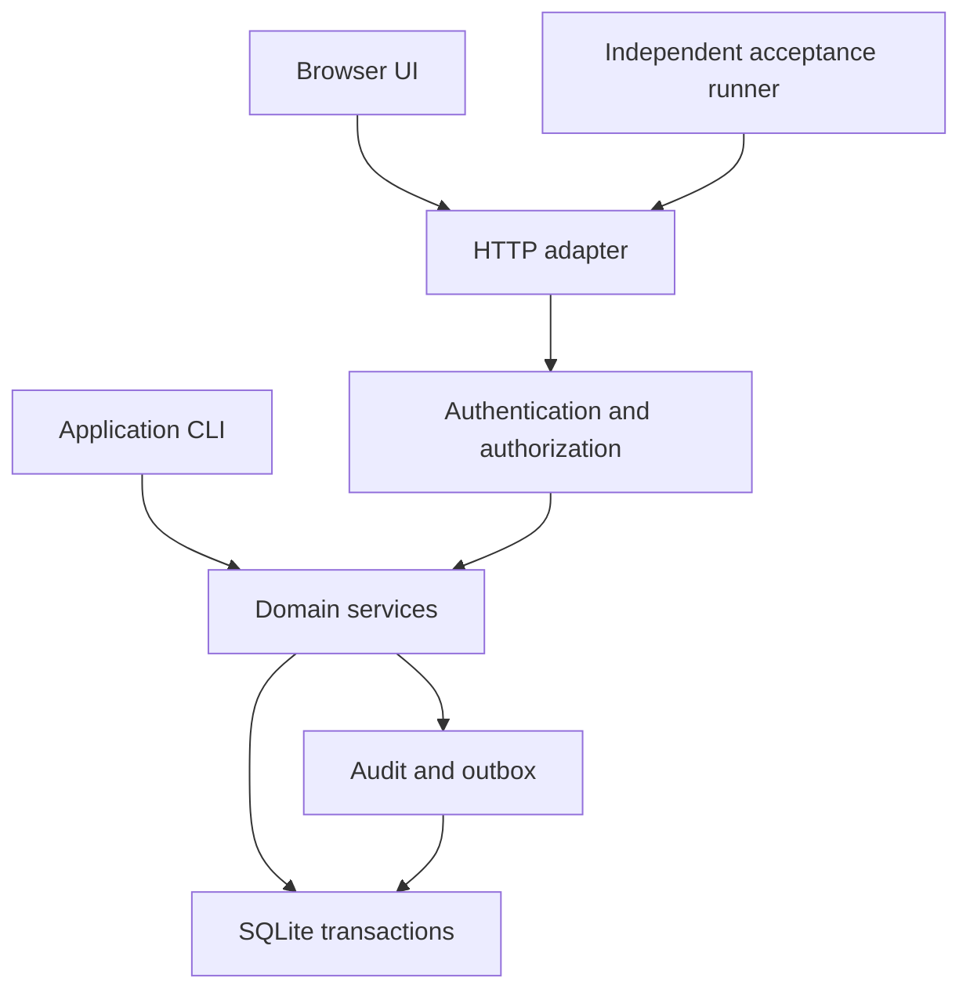

# DevFoundry large-scale build and test project

## OpsLedger: a multi-site operations application built through DevFoundry

Version: 1.0  
Prepared: November 6, 2026  
Audience: OpenCode acting as the outer project driver, the DevFoundry operator, and human reviewers  
Source: the attached `Pasted text(8).txt`, a summary of `docs/guides/using-devfoundry.md`

## 1. What to do with this file

Give this entire file to OpenCode in a dedicated project workspace. Start with the instruction block in section 2.

**Scope assumption:** DevFoundry already exists and runs in the DGX Kubernetes lab described in the attachment. Build a substantial new application **through that installation**, and use the work to test DevFoundry itself. This is a project specification for exercising the existing platform, rather than a specification for reimplementing its backend.

The project is **OpsLedger**, a multi-organization operations system for sites, equipment, work orders, spare parts, purchase requests, incident follow-up, and reporting. It produces a useful, connected application and a repeatable acceptance campaign for DevFoundry.

The deliverables have two separate verdicts:

| Deliverable | Question answered | Evidence |
| --- | --- | --- |
| OpsLedger application | Did the generated software implement the requested behavior correctly? | Application tests, independent acceptance tests, browser review, migrations, concurrency and performance results |
| DevFoundry acceptance campaign | Did the platform isolate, execute, validate, present, authorize, and publish each change correctly? | Task events, base commits, patch digests, review packets, decision records, publication records, and platform test results |

“Large-scale” here means a long, dependent development program, substantial business logic, meaningful data volume, and controlled concurrency. This file does not assert that the application is a distributed production system or that DevFoundry supports thousands of concurrent tasks.

This document is a specification, not an execution report. No lab connectivity, credentials, installed version, application implementation, or passing test results have been verified while preparing it.

## 2. Copy this instruction into OpenCode

```text
Read DevFoundry_Large_Scale_OpenCode_Project.md completely.

Act as the outer driver for the OpsLedger development and DevFoundry
acceptance campaign. Treat the attached DevFoundry guide and the installed
CLI/OpenAPI contract as the authority for platform operations.

First inspect the workspace and installed tools. Preserve existing work.
Create the local campaign scaffold, environment preflight, dependency graph,
task-request files, review handoff format, and resumable evidence journal.
Bootstrap only the minimal runnable OpsLedger repository and its validation
gate. Establish its owner-reviewed base before submitting feature work.

Implement OpsLedger features through DevFoundry implement/workspace tasks,
using the polyglot environment. Do not silently build feature code directly
in the outer workspace if DevFoundry is unavailable. Record the blocker and
continue only independent local preparation.

Start with B01-B08, then submit T001, validate its evidence, and prepare the
human review handoff. Continue eligible independent tasks while reviews are
pending, within the campaign concurrency limit. Dependent tasks must wait
for accepted changes to be present on their actual remote base.

Never approve or reject generated work as an independent human reviewer.
Never use a second account to simulate independent review. Never merge.
Do not push accepted patches or publish draft PRs without the relevant
owner authorization and the required human decision. Do all preparation
that can be completed before those boundaries.

Use small requests, real tests, immutable task bases, and exact patch
digests. Record observed results honestly. A blocked, manual, or unrun
check must never become a pass. Resume from the journal after interruption.
```

The driver is an ordinary OpenCode session outside DevFoundry. It is not a request to enable DevFoundry's unsupported `coordinate` interaction mode. The coding agent inside a task receives a self-contained small request, rather than this entire specification.

## 3. Existing DevFoundry constraints to preserve

These are supplied baseline facts from the attachment. Confirm the installed release before execution and record any differences. Do not turn a difference into an unrequested platform modification.

| Area | Attached guide says | Consequence for this project |
| --- | --- | --- |
| Execution | `implement` is the only interaction mode that executes | Generate a dependency plan locally; submit implementation tasks individually |
| Task isolation | Repository clone in a workspace pod, followed by a clean validation pod | Verify the patch on the exact base in a fresh checkout too |
| Model | OpenCode uses the RouteForge alias `df.patch-worker`; lab model described as GLM Flash | Record the actual pack, alias, and resolved model when exposed; do not hard-code an unverified model ID |
| Environment | `polyglot`: Python 3.12, Node 22, npm, make; `opencode-default` lacks the required language tools | Use `polyglot`; record its qualified build/digest |
| Network | Model gateway and public GitHub only for task workloads; validation has no network | No task-time downloads, package installs, CDNs, cloud databases, or external APIs |
| Validation | Base must contain `check.sh`; changing it fails validation | Establish it before feature tasks; add tests in directories it already discovers |
| Runtime | Up to three pack attempts; 1,800-second agent limit; 300-second validation check | Target a small coherent patch per task and a fast complete validation suite |
| Lifecycle | Failed, cancelled, and completed tasks are terminal | A repair is a new task with a new ID and recorded predecessor |
| Review | Review packet is mechanical; approval binds a patch digest | Read the diff and require an independent human decision |
| Git | Approval does not update the repository; DevFoundry never merges | Explicitly carry accepted patches into the next remote base |
| Publication | Accepted draft-PR task, registered host, CI paths untouched, secret scan | Exercise publication in a separate designated test repository |
| Repositories | Public GitHub repositories supported in the described lab | Use only synthetic business data; retain campaign credentials and internal evidence outside the public repository |
| Readiness | Advisory and separate from `check.sh`; detected commands may try npm/pip | Set explicit build/test commands when supported; do not require package installation |
| Platform admin | Installation admin has no automatic access to unrelated projects | Test membership boundaries with designated test identities |

The guide also says developers can decide their own tasks while instructing users not to approve their own work. Keep the stricter campaign rule of independent human review. Record the installed authorization behavior separately instead of claiming the product necessarily enforces separation of duties.

The supplied LAN URL is `http://10.89.195.201:30861`. Treat it as an operator-provided candidate, not a verified endpoint. Keep it in local configuration as `DEVFOUNDRY_URL`; do not put authentication data in task requests or public files.

## 4. Reuse decisions and scope boundaries

Use the existing DevFoundry scheduler, pods, packs, review packets, CLI, API, and RouteForge integration. Do not build a second task scheduler, agent framework, model gateway, identity platform, or Kubernetes operator for this benchmark.

The following alternatives were checked as a bounded discovery exercise on November 6, 2026:

| Candidate | Category and evidence | Fit for this assignment | Decision |
| --- | --- | --- | --- |
| [Atlas CMMS](https://github.com/Grashjs/cmms) | Complete maintenance application; repository documentation inspected | Its documented assets, inventory, work orders, and approvals show that this is a realistic connected workflow. Its Docker and service stack differ from this lab's dependency-free task environment. | A useful adoption candidate if the objective becomes operating a maintenance product. Do not copy its code into this benchmark. |
| [SWE-bench](https://github.com/SWE-bench/SWE-bench) | Software engineering evaluation system; README inspected | Useful for independent issue-to-patch evaluation, but its documented Docker/package setup and existing issue corpus do not directly exercise this installation's human review and publication workflow. | Consider a separate future comparison track; reuse its clean-base evaluation principle here. |
| Python standard library and SQLite | Components; official documentation inspected | Supply persistence, JSON/CSV, HTTP test clients, unit testing, subprocess control, and temporary files without downloading packages | Compose these components for the lab baseline. |
| Node's built-in test runner | Component; Node 22 documentation inspected | Runs pure JavaScript logic tests without npm packages | Reuse for frontend logic; browser interaction still requires real browser verification. |

The discovery covered complete operations applications, repository-level agent benchmarks, and offline standard-library implementations, including a second pass on discovered candidates. Sources were inspected, not installed or tested. No exhaustive product comparison or licensing determination is claimed. If importing third-party code later, verify its exact license and notices first.

The custom work is justified by the evaluation goal: a controllable sequence of new features, independent acceptance criteria, known defect fixtures, and observable DevFoundry boundaries. Buying or deploying an already completed business application would not produce the same development campaign.

## 5. Application outcome and end-to-end story

OpsLedger supports several organizations, each with multiple sites. A site supervisor records equipment, opens a repair, assigns a technician, reserves parts, orders a shortage, records receipt, completes the repair, and reviews costs and downtime. An auditor can reconstruct who changed the records without gaining write access.

The application itself does not call an LLM. All model use belongs to DevFoundry's development workflow through RouteForge. This keeps business acceptance deterministic and makes model failures easier to separate from application defects.

Required golden journey:

1. An organization administrator creates two sites and assigns different site memberships.
2. A supervisor registers an asset and raises a high-priority work order.
3. The supervisor assigns a technician; an unassigned technician is denied the assignment-specific write operation.
4. The technician starts the work and requests two parts. Available stock is one, so reserving two is rejected without partial changes.
5. A purchasing user submits a purchase request for ten parts. A different authorized approver approves it.
6. A partial receipt of four units increases stock once. Replaying the same receipt command has no second stock effect.
7. The technician reserves two units, consumes one, and releases the unused reservation.
8. The technician records labor and completion. The supervisor closes the work order after checking its completion requirements.
9. The dashboard shows the expected work-order counts and integer-cent costs.
10. A user from another organization cannot retrieve any record, search result, count, export row, or audit event from this journey.
11. Backup and restore reproduce the business records and ledger balances.
12. A reopened work order preserves the prior history and records a reason.

Use this locked small fixture for the first independent end-to-end oracle: opening on-hand 1, opening reserved 0, ordered quantity 10, received quantity 4, reserved quantity 2, consumed quantity 1, released quantity 1. Final on-hand is 4, reserved is 0, available is 4, and outstanding order quantity is 6. Use standard part cost 2,500 cents and 90 labor minutes at 8,000 cents per hour. The repair cost is 14,500 cents: 2,500 parts plus 12,000 labor. Repeat the receipt with its original idempotency key and require these values to remain unchanged. Keep the oracle outside agent-editable tests.

Use entirely fictional organizations, names, assets, inventory, vendors, and incidents. No live purchasing, payments, equipment control, email sending, or regulated records are included.

## 6. Architecture and supported execution profiles

### 6.1 Baseline: lab-compatible application

| Layer | Choice | Requirements |
| --- | --- | --- |
| Backend | Python 3.12 standard library | No FastAPI, Django, Flask, ORM, or pip installation in this profile |
| Data | SQLite through `sqlite3` | One application instance, local disk, foreign keys, explicit transactions, migrations, parameterized SQL |
| HTTP adapter | Small adapter around `BaseHTTPRequestHandler`/`ThreadingHTTPServer` | Loopback by default; explicit routes and bounded input; benchmark use only |
| Frontend | HTML, CSS, ES modules | Same-origin assets; no bundler, CDN, external font, or npm dependency |
| Backend tests | `unittest` and `unittest.mock` | Fresh databases and isolated temporary directories |
| Frontend logic tests | `node:test` and `node:assert/strict` | Pure modules importable in Node 22 without DOM emulation |
| Application CLI | `argparse` | Migrate, seed, serve, reconcile ledgers, backup, restore, and diagnostics |
| Performance runner | Standard-library HTTP clients and `concurrent.futures` | Outside `check.sh`; bounded duration and concurrency |
| Platform campaign driver | Standard-library Python plus installed `devfoundry` CLI | No embedded admin tokens; inspect current CLI JSON and API schema |

Python explicitly states that `http.server` is not recommended for production. This baseline is a private lab benchmark. A reverse proxy alone does not turn it into a production service. A later qualified production profile can use an approved framework, production server, PostgreSQL, OIDC, TLS, and browser automation, after those dependencies exist in pinned environments. That extension is a separate workstream, not a prerequisite for this campaign.

SQLite WAL is permitted only on local storage supported by SQLite's same-host requirements. Do not place the database on NFS or run multiple Kubernetes replicas against a shared SQLite file. Record journal mode and SQLite version. A larger dataset does not establish multi-node write scalability.

Use a modular monolith. Keep HTTP handlers thin and put business transactions in services with explicit identity context. Do not create microservices just to increase the number of files.



### 6.2 Repository separation

Use a public GitHub repository named `opsledger-benchmark` for the application. Use a separate local directory named `devfoundry-campaign` for driver code, task requests, acceptance results, review handoffs, and local configuration. The latter is not automatically uploaded to GitHub or submitted to DevFoundry.

The campaign driver may be committed to an owner-selected private repository later. Application task pods do not need that repository. Never put credentials, private LAN traces, or raw task logs in the public application repository.

### 6.3 Required application layout

| Path | Responsibility |
| --- | --- |
| `README.md` | Installation-free quick start, lab limitations, meaningful demo story; at least 200 bytes from bootstrap |
| `AGENTS.md` | Task guardrails, architecture boundaries, test locations, protected validation rules |
| `check.sh` | Owner-reviewed, fixed validation entry point, established before feature tasks |
| `opsledger/__init__.py`, `__main__.py` | Package and CLI entry point |
| `opsledger/core/` | Errors, identity context, clock, IDs, database connections, migration runner |
| `opsledger/identity/` | Users, sessions, role checks, organization/site membership |
| `opsledger/assets/` | Sites, equipment, maintenance plans |
| `opsledger/workorders/` | State transitions, assignments, labor, checklists, comments |
| `opsledger/inventory/` | Parts, balances, reservations, movements, reconciliation |
| `opsledger/purchasing/` | Requests, approvals, purchase orders, receipts |
| `opsledger/incidents/` | Incidents, corrective actions, relationships to repairs |
| `opsledger/reporting/` | Authorized search, dashboards, CSV exports |
| `opsledger/audit/` | Append-only application audit and transactional outbox |
| `opsledger/http/` | Routing, bounded JSON, error mapping, cookie/CSRF handling, static allowlist |
| `opsledger/migrations/` | Append-only numbered SQL migrations with recorded checksums |
| `web/` | HTML, CSS, ES modules, no generated bundles |
| `tests/unit/`, `tests/integration/`, `tests/security/` | Python discovered tests; each directory is a regular package |
| `tests/js/` | Files named `*.test.mjs`, discovered by the fixed gate |
| `docs/` | Architecture, API contract, data dictionary, operator runbook, migration notes |

Add `__init__.py` to every Python test package. Python 3.12 test discovery must not silently omit nested directories.

### 6.4 Required campaign layout

| Path | Responsibility |
| --- | --- |
| `config.example.json` | Non-secret configuration shape; placeholders rather than usable tokens |
| `driver/` | Preflight, request rendering, CLI adapter, event recording, resume logic, reporting |
| `requests/` | Small self-contained task files, one per backlog item or split child |
| `acceptance/` | Operator-controlled black-box tests and independent golden fixtures |
| `platform_cases/` | Data-driven DevFoundry acceptance scenarios |
| `journal/events.jsonl` | Append-only campaign events; private local evidence |
| `journal/index.json` | Rebuildable projection of the journal |
| `evidence/<campaign>/<task>/` | Sanitized events, digests, verdicts, review handoff, commands and exit codes |
| `reports/` | Application verdict, platform verdict, blockers, defects, performance measurements |

These are deliverables for OpenCode to implement, not files supplied alongside this Markdown document.

## 7. Data model and invariants

### 7.1 Common rules

- Store money as integer minor units with currency `USD` in the baseline. Never use binary floating point for totals.
- For repair reporting, capture a part's standard unit cost on each consumption and a worker's hourly rate on each labor entry. Compute labor cost with integer round-half-up to cents, and aggregate the recorded entry costs. Later catalog/rate changes do not rewrite history. Receipt totals report actual purchase cost separately; the baseline is not a financial inventory valuation system.
- Store inventory and labor quantities as bounded non-negative integers; labor uses minutes. No fractional stock in the baseline.
- Store timestamps as canonical UTC RFC 3339 strings at second precision. Use an injected clock in tests. Site timezone is display metadata in this baseline; calendar recurrence uses UTC dates only.
- Use opaque IDs. IDs are not authorization. Every lookup and join requires the authenticated organization context.
- Put `organization_id` on every tenant-owned table and use composite uniqueness/foreign keys to prevent cross-organization links.
- Use soft deletion/archive for referenced business objects. Never delete inventory movements, approvals, receipts, or audit history through ordinary routes.
- Include a monotonically increasing `version` on mutable aggregates; reject stale mutations with HTTP 409.
- Changes to business records and their audit/outbox records commit atomically.
- Do not rely on a client-submitted organization, actor, price total, approval identity, or audit timestamp as authoritative.

### 7.2 Entities

| Aggregate | Required records and constraints |
| --- | --- |
| Identity | `organizations`, `users`, `memberships`, `site_memberships`, `sessions`; unique normalized email per organization; inactive membership denies access immediately |
| Locations | `sites`; unique site code within organization; site archive requires no open work orders |
| Equipment | `assets`; unique asset tag per organization; one site, optional archived status, purchase cost, criticality, version |
| Work | `work_orders`, `assignments`, `work_order_events`, `checklist_items`, `labor_entries`, `comments`; one asset/site/organization, validated transitions, immutable status history |
| Inventory | `parts`, `stock_locations`, `stock_balances`, `stock_movements`, `reservations`; one part/location balance; movement ledger is the accounting source |
| Purchasing | `vendors`, `purchase_requests`, `purchase_request_lines`, `approvals`, `purchase_orders`, `purchase_order_lines`, `receipts`, `receipt_lines`; requester cannot approve own request |
| Maintenance | `maintenance_plans`, `maintenance_runs`; UTC date-based interval, unique plan/scheduled-date generation key |
| Incidents | `incidents`, `corrective_actions`, `incident_work_orders`; no safety certification claims |
| Integrity | `audit_events`, `outbox_events`, `idempotency_records`, `schema_migrations`; bounded retention for sessions/idempotency, immutable business history |

### 7.3 Role model

Application roles are independent of DevFoundry platform roles.

| Application role | Scope and actions |
| --- | --- |
| Organization admin | Manage organization members and sites; all organization business operations except bypassing self-approval restrictions |
| Site supervisor | Manage assets, assignments and work-order closure within assigned sites; approve purchase requests when separately granted approver permission |
| Technician | Read assigned sites; work on assigned work orders, record labor, reserve/consume/release parts for those orders |
| Purchasing user | Manage vendors, create purchase requests, issue approved orders, record receipts within assigned sites |
| Auditor | Read authorized sites, audit, reports, exports; no business writes |

Permissions are explicit operation checks in services. Hiding a button is insufficient. A purchasing user does not automatically become an approver. Represent `purchase.approve` as an explicit membership permission and prohibit self-approval even for an admin.

No account has implicit cross-organization business access. Provisioning test organizations is an offline operator CLI action, separate from application sessions.

### 7.4 Work-order transitions

| Current state | Allowed next states | Preconditions |
| --- | --- | --- |
| `open` | `assigned`, `cancelled` | Assignment requires an active technician in the same site; cancellation requires a reason |
| `assigned` | `in_progress`, `open`, `cancelled` | Start requires assigned technician or supervisor; return to open removes active assignment |
| `in_progress` | `blocked`, `completed`, `cancelled` | Block/cancel require reason; completion requires mandatory checklist items, completion note, and no outstanding reservation |
| `blocked` | `in_progress`, `cancelled` | Unblock requires a reason and valid assignment |
| `completed` | `closed`, `in_progress` | Supervisor closes; reopen requires a reason |
| `closed` | `open` | Supervisor reopens with a reason; prior labor, consumption and history remain |
| `cancelled` | none | Release active reservations in the same transaction; preserve history |

Each transition checks the expected aggregate version. State changes append one event and one audit record. Replaying an idempotent command must not append duplicates.

### 7.5 Inventory and purchasing transactions

For each part/location:

`available = on_hand - reserved`, with `on_hand >= reserved >= 0`.

Ledger effects:

| Operation | On-hand delta | Reserved delta | Rule |
| --- | ---: | ---: | --- |
| Receive stock | `+quantity` | 0 | Only against approved purchase-order outstanding quantity |
| Reserve | 0 | `+quantity` | Quantity must not exceed available; work order and stock belong to the same authorized site |
| Release | 0 | `-quantity` | Must reference an active reservation with sufficient remaining quantity |
| Consume reservation | `-quantity` | `-quantity` | Consumption cannot exceed remaining reserved quantity |
| Adjust | signed quantity | 0 | Supervisor/admin permission plus reason; new on-hand cannot fall below reserved |

Use a short explicit write transaction with atomic conditional updates. On contention, return a bounded retryable error rather than leaking a traceback. Use a separate SQLite connection for each thread/request. Do not fix threading failures by indiscriminately disabling connection thread checks.

Receiving an order updates receipt rows, stock movements, balances, audit, and the idempotency record in one transaction. Partial receipts are allowed. Over-receipt is rejected. A cancelled request cannot issue an order. Editing submitted purchase lines invalidates approval and requires resubmission; never approve one total and order another.

Idempotency scope is organization + actor + operation + key. Store a canonical request digest. The same key and payload returns the original result. The same key with another payload returns 409. Concurrent repeats must produce one business effect. Recheck current authentication and authorization before exposing a replayed result, then resolve a matching prior result before rejecting its now-stale expected version. The original version was consumed by the original successful operation.

## 8. API and frontend contracts

### 8.1 API conventions

Use `/api/v1` for OpsLedger. This prefix is unrelated to DevFoundry's own API.

- Successful item responses: `{"item": {...}}`; lists: `{"items": [...], "next_cursor": null}`.
- Error responses: `{"error": {"code": "version_conflict", "message": "...", "request_id": "..."}}`.
- HTTP 400 malformed input; 401 missing/expired login; 403 known in-scope forbidden operation; 404 unknown or cross-organization resource; 409 version/idempotency/state conflict; 413 oversized body; 415 unsupported media type; 422 valid JSON with invalid business values; 429 configured rate limit; 503 bounded database contention/unavailable service.
- Default list size 25, maximum 100. Stable sorting uses `(created_at, id)` with explicit tie-breaking. Test paging under inserts; do not claim snapshot consistency unless implemented.
- Deny unknown mutation fields. Bound string lengths, collection sizes, integer ranges, request bodies, and CSV imports.
- Apply filters before pagination and counts. Whitelist sortable fields; never interpolate a client-provided SQL column name.
- Require `Idempotency-Key` for purchase approval, order issue, receipt, stock adjustment, consumption, maintenance generation, and work-order transitions.
- Mutations of existing aggregates supply `expected_version` in JSON. Create operations do not require it.
- No unbounded “export everything” route. CSV exports require authorized filters and a configured row limit.

### 8.2 Endpoint groups

| Group | Minimum operations |
| --- | --- |
| Session | `POST /auth/login`, `POST /auth/logout`, `GET /me`, `GET /auth/csrf` |
| People | List/add/deactivate organization memberships; grant/revoke site access and explicit approver permission |
| Sites/assets | List/create/update/archive sites and assets; retrieve asset work history |
| Work orders | Create/list/get/update; assign; transition; checklist; labor; comments; event history |
| Inventory | Part/location CRUD; balances; reserve/release/consume; reasoned adjustments; reconciliation report |
| Purchasing | Vendors; request lines; submit/approve/reject; issue order; partial receipt; receipt history |
| Maintenance | Plan CRUD; due-date preview; deterministic generation; run history |
| Incidents | Incident CRUD; corrective actions; link work order; close after actions complete |
| Reporting | Authorized search, site dashboard, asset cost report, bounded CSV export |
| Diagnostics | `/healthz` process health and `/readyz` schema/database readiness; never expose secrets |

Freeze exact request/response fields in `docs/api.json` as implementation progresses. OpenAPI-shaped JSON may be written by hand in the dependency-free profile; do not require a schema library to run tests. Validate representative payloads with explicit owner-reviewed tests.

### 8.3 Authentication and input security

Implement opaque random sessions with server-side token hashes, expiry, revocation, and constant-time comparisons where appropriate. Store password hashes using `hashlib.scrypt` with per-password random salts and a recorded parameter version; verify availability during preflight. Choose and document work factors, benchmark login, and do not use a fast unsalted hash. Synthetic test authentication may use isolated fixture parameters, with an explicit separate path that cannot select weak parameters in ordinary operation.

Use HttpOnly, SameSite cookies. Secure cookies are required for the later HTTPS profile; explicit loopback lab mode permits HTTP. Require origin and CSRF checks on cookie-authenticated mutations, including login. Issue a short-lived anonymous CSRF context before login, then rotate it with the authenticated session. Never store bearer/session tokens in browser localStorage or log request cookies/password fields.

Serve only allowlisted static files below `web/`; refuse traversal and symlinks. Use `textContent` for user text. Use a restrictive content-security policy compatible with local ES modules and external CSS. Do not serve the repository root, SQLite files, journals, or evidence directories. Reject unexpected Host values and oversized/incomplete bodies with bounded timeouts.

Test SQL parameterization, reflected/stored script text, cross-organization IDs, CSRF, session expiry/deactivation, CSV spreadsheet formula injection, sort injection, and mass assignment. These are application requirements, not a security certification.

### 8.4 UI acceptance

Build working pages for login, site/asset lists, work-order board/detail, parts/balances, purchase approval/receipt, maintenance plans, incidents, dashboard, and audit history.

Use a readable system font, consistent spacing, visible status text, labels, keyboard focus, empty/error/loading states, and confirmation of consequential business changes. Support 390px and 1440px viewports. Forms preserve entered data on server validation errors. Display conflicts as actionable messages with a refresh option. Show permissions accurately but always enforce them server-side too.

Pure JS tests cover formatting, client validation, filter serialization, and state reducers. They do not prove a browser can render or operate the UI. Browser golden journeys and keyboard checks are manual in the baseline unless an approved preinstalled browser automation environment is available. An unavailable browser check is `not_run`, never a JS-test-derived pass.

## 9. Bootstrap and fixed validation gate

The platform cannot bootstrap `check.sh` through a patch that is forbidden from changing it. Resolve this by creating the initial repository locally, reviewing that bootstrap, and putting it on the remote base before the first DevFoundry task.

### 9.1 Bootstrap backlog

| ID | Work | Completion criterion |
| --- | --- | --- |
| B01 | Inspect workspace, CLI help, credentials availability, project/repo roles, environment build, Git remotes | Preflight report lists observed values and blockers without exposing secrets |
| B02 | Create separate application/campaign directories and non-secret config schema | Public application directory contains no campaign configuration or evidence |
| B03 | Create minimal package, CLI `--help`, README, AGENTS, test packages, JS baseline module/test | A real CLI smoke test and real JS test pass; no feature implementation is hidden in bootstrap |
| B04 | Establish the fixed `check.sh` and executable validation helper embedded below | Nonzero tests fail the gate, zero Python tests fail, JS tests are required, exit codes propagate |
| B05 | Create driver journal schema, task template, request renderer, and dry-run adapter tests | Simulated CLI replies are clearly labelled fixtures; no live task is claimed |
| B06 | Human review of bootstrap and initial remote publication | Record remote base SHA and check.sh digest; missing push authorization remains a blocker |
| B07 | Register repository if needed, inspect supported readiness configuration, run readiness | Existing registration is reused; readiness and gate results are separate fields |
| B08 | Run a tiny onboarding task and the first clean-checkout validation | Human may reject onboarding as described in the guide; no feature task starts without a usable base |

### 9.2 Initial `check.sh`

Create the following at bootstrap. Its embedded Python is intentionally fixed with the shell entry point. Do not move validation dispatch into an agent-editable helper and then claim it is protected.

```bash
#!/usr/bin/env bash
set -euo pipefail
cd -- "$(dirname -- "$0")"
export PYTHONDONTWRITEBYTECODE=1
export PYTHONHASHSEED=0
export TZ=UTC
python3 - <<'PY'
from pathlib import Path
import subprocess
import sys
import unittest

root = Path.cwd()
if sys.version_info[:2] != (3, 12):
    raise SystemExit("Python 3.12 required by qualified baseline")

sources = sorted((root / "opsledger").rglob("*.py"))
if not sources:
    raise SystemExit("No application Python source files")
for path in sources:
    compile(path.read_text(encoding="utf-8"), str(path), "exec")

suite = unittest.defaultTestLoader.discover(
    start_dir=str(root / "tests"), pattern="test_*.py", top_level_dir=str(root)
)
if suite.countTestCases() == 0:
    raise SystemExit("No Python tests discovered")
result = unittest.TextTestRunner(verbosity=2).run(suite)
if not result.wasSuccessful():
    raise SystemExit(1)
if result.skipped or result.expectedFailures or result.unexpectedSuccesses:
    raise SystemExit("Skipped/expected-failure tests are not allowed in the fast gate")

node = subprocess.run(
    ["node", "-p", "process.versions.node.split('.')[0]"],
    check=True, capture_output=True, text=True, timeout=10
).stdout.strip()
if node != "22":
    raise SystemExit("Node 22 required by qualified baseline")
for path in sorted((root / "web").rglob("*.mjs")):
    subprocess.run(["node", "--check", str(path)], check=True, timeout=10)
js_tests = sorted((root / "tests" / "js").rglob("*.test.mjs"))
if not js_tests:
    raise SystemExit("No JavaScript test files discovered")
subprocess.run(
    ["node", "--test", *map(str, js_tests)], check=True, timeout=60
)
print("OPSLEDGER_FAST_GATE_OK")
PY
```

All optional, slow, soak, and environment-dependent checks live under the campaign directory, outside this fast discovery tree. Do not insert skipped future-feature tests to make an incomplete milestone look implemented. Node TAP results must also be checked for skipped/TODO/zero assertion patterns by the campaign's acceptance review; a zero exit code alone is insufficient evidence of meaningful JS tests.

This gate detects failures and discovers new tests. It is not a hostile-code sandbox or proof that editable tests cannot be weakened. The external campaign must inspect changed paths, compare existing tests, and run independent acceptance checks. Only claim additional platform-protected paths if installed policy actually supports and enforces them.

### 9.3 Test ownership and runtime budgets

- Feature tasks may add tests. Editing an existing accepted test requires a specific requirement and reviewer attention; deleting/disabling an accepted assertion is not a routine repair.
- The outer acceptance suite is maintained outside the application checkout. Task code cannot update its expected results through its patch.
- Add a milestone's acceptance cases before submitting its tasks. Future milestone cases remain inactive until their declared checkpoint; they must not break the current fast gate.
- Target the full fast gate below 180 seconds on the qualified pod, leaving margin below the documented 300-second limit. Record the actual runtime and stop adding slow fixtures if the budget is threatened.
- If `check.sh` genuinely needs correction, stop feature submission. Prepare a minimal owner-reviewed bootstrap update, publish the new base through the authorized Git path, record its new digest, then resume. Never sneak the change into a task patch.

## 10. Development backlog: 80 feature tasks

Each row is a small deliverable, not a command to implement the whole milestone in one pod. Expand each row into a self-contained request with current file paths, business rules, commands, expected outcomes, and allowed changes. Split a row into child IDs if it exceeds the task budget. Every task must include the tests appropriate to its behavior.

Dependencies below are the minimum functional dependencies. The driver also waits for the preceding milestone checkpoint, uses actual committed file contracts, and serializes edits to shared modules. A dependency diagram does not authorize concurrent overlapping patches.

### M1: persistence and HTTP foundation

| ID | Task | Depends on | Required acceptance |
| --- | --- | --- | --- |
| T001 | Typed application errors and injectable UTC clock | B08 | Fake-clock test is deterministic; error codes are stable |
| T002 | SQLite connection factory and transaction context | T001 | Foreign keys on; rollback on exception; no shared-thread connection |
| T003 | Migration runner and migration history checksums | T002 | Empty DB migrates; second run no-op; changed applied migration refused |
| T004 | Organizations, users and membership schema | T003 | Unique normalized identity; cross-organization relationship rejected |
| T005 | HTTP router and JSON error envelope | T001 | Unknown route, bad method, malformed JSON, body limit tested |
| T006 | CLI migrate/serve and bounded health/readiness handlers | T003,T005 | Missing schema is unready; clean start and shutdown work |
| T007 | Synthetic small seed generator and fixture manifest | T004 | Same seed yields same business rows; no real data |
| T008 | Bootstrap UI shell and safe static-file routing | T005 | Local assets load; repository/database/traversal paths refused |

M1 checkpoint: fresh checkout runs the gate, migrates, seeds, and serves a health response. No mock JSON substitutes for persistence.

### M2: identity and access

| ID | Task | Depends on | Required acceptance |
| --- | --- | --- | --- |
| T009 | Password-hash records and offline user provisioning | T004 | Correct/wrong passwords, random salts, unavailable scrypt behavior tested |
| T010 | Hashed sessions, expiry, revocation and logout | T009,T005 | Expired/revoked tokens denied; raw token absent from DB/logs |
| T011 | Login CSRF context and authenticated mutation CSRF checks | T010 | Cross-origin and missing-token requests denied; rotation tested |
| T012 | Organization identity context in repositories/services | T010 | Cross-organization IDs return 404 without existence leak |
| T013 | Role and explicit permission checks | T012 | Auditor writes denied; approver grant distinct from purchasing role |
| T014 | Site memberships and immediate member deactivation | T013 | Existing session loses access on deactivation/site revocation |
| T015 | Login and account UI with accessible error states | T011 | No localStorage session; login/logout work in browser checklist |
| T016 | Authorization matrix regression tests and docs | T014,T015 | Every declared role/action pair has observed or explicitly pending evidence |

M2 checkpoint: independent two-organization read/write isolation and session tests pass. This is a mandatory gate before business modules grow.

### M3: sites and equipment

| ID | Task | Depends on | Required acceptance |
| --- | --- | --- | --- |
| T017 | Site create/list/update with scoped unique codes | T014 | Same code allowed in another organization, duplicate in same refused |
| T018 | Asset schema, create and get | T017 | Asset/site relationship scoped at service and database levels |
| T019 | Asset filtered list with stable pagination | T018 | Identical timestamps do not duplicate or omit stable rows |
| T020 | Optimistic versions and asset updates | T018 | Second writer with stale version gets 409; first change retained |
| T021 | Site/asset archive rules | T020 | Referenced records retained; archived objects cannot accept new work |
| T022 | Asset audit events in the same transaction | T020 | Forced audit failure rolls back business mutation |
| T023 | Site and asset list/detail/edit UI | T019,T021 | Keyboard-accessible forms; errors preserve values |
| T024 | Search/filter JS modules and node tests | T023 | Query encoding and empty/zero values tested without DOM claims |

M3 checkpoint: authenticated operators can manage real site/equipment data; cross-site denials are checked independently.

### M4: work-order lifecycle

| ID | Task | Depends on | Required acceptance |
| --- | --- | --- | --- |
| T025 | Work-order schema/create/list/get | T018 | Asset, site and requester context consistent |
| T026 | Assignment with active same-site technician | T025 | Cross-site/inactive assignee denied |
| T027 | Transition service and immutable history | T026 | All allowed and forbidden state pairs exercised |
| T028 | Mandatory checklist and completion checks | T027 | Incomplete mandatory item prevents completion |
| T029 | Labor entries, integer-cent labor calculation | T027 | Negative minutes refused; edited totals computed server-side |
| T030 | Version-aware comments and work history | T027 | User text is literal; author identity derived from session |
| T031 | Work-order board/detail/action UI | T028,T029,T030 | Actions match state/role; conflicts require refresh |
| T032 | Work-order audit and lifecycle black-box regression | T031 | Open-to-close and reopen preserve correct history |

M4 checkpoint: first complete work-order flow works without inventory. Inventory-specific completion rules become active when M5 lands and are tested then.

### M5: inventory integrity

| ID | Task | Depends on | Required acceptance |
| --- | --- | --- | --- |
| T033 | Parts and stock-location records | T017 | Scoped SKU and location uniqueness |
| T034 | Balance and movement ledger, opening adjustment | T033 | Reconciliation matches movement sum; reason required |
| T035 | Transactional reservation service | T034,T025 | Insufficient stock changes nothing |
| T036 | Reservation release and consumption | T035 | Quantities cannot be reused or exceed reservation |
| T037 | Idempotency record core and digest conflict checks | T002,T012 | Concurrent same-key command causes one effect; different payload 409 |
| T038 | Work-order transition integration with reservations | T027,T036,T037 | Cancel releases reservations atomically; completion refuses outstanding reservation |
| T039 | Inventory UI, movements and low-stock views | T034,T036 | Available/on-hand/reserved shown consistently |
| T040 | Multi-connection race tests and reconciliation CLI | T038 | Competing reservations never oversell; ledger and balances agree |

M5 checkpoint: no negative availability or duplicated stock effect under the defined race suite. Re-run M4 with the now-active inventory completion rules.

### M6: purchasing and receiving

| ID | Task | Depends on | Required acceptance |
| --- | --- | --- | --- |
| T041 | Vendors and purchase-request lines/totals | T033 | Integer-cent totals; no cross-organization vendor/part |
| T042 | Submit/reject/approve request lifecycle | T041,T037 | Requester cannot approve; inactive approver denied |
| T043 | Invalidate approval when material fields change | T042 | Approved total cannot be silently changed |
| T044 | Issue one order from approved request | T043 | Idempotent issue; rejected/unapproved request refused |
| T045 | Atomic partial receipt into stock ledger | T044,T034 | Receipt adds exact units once; replay no second effect |
| T046 | Over-receipt, duplicate and stale-version races | T045 | Outstanding quantity never below zero; atomic rollback |
| T047 | Request/approval/order/receipt UI | T046 | Self-approval disabled and server denial independently tested |
| T048 | Purchasing golden journey and reconciliation export | T047 | Independent expected stock and cost values match |

M6 checkpoint: execute the full stock-shortage-to-repair story using API calls and a browser review.

### M7: recurring work and incidents

| ID | Task | Depends on | Required acceptance |
| --- | --- | --- | --- |
| T049 | UTC date-based maintenance plans | T018 | Positive day interval; bounded horizon; archived assets refused |
| T050 | Due-date preview using injected clock | T049 | Month/year/leap-day boundaries deterministic |
| T051 | Idempotent generation of due work orders | T050,T025,T037 | Same plan/date produces one order, including concurrent runs |
| T052 | Persisted maintenance run/outbox and bounded retry | T051 | Simulated crash/retry creates no duplicate work order |
| T053 | Incident records and linked work orders | T025 | Linked objects share organization/site; no unsafe text rendering |
| T054 | Corrective-action assignments and closure rules | T053 | Incident cannot close with required action open |
| T055 | Maintenance and incident UI | T052,T054 | Preview/generate and open-action state visible |
| T056 | Time-boundary and interruption regression suite | T055 | Repeatable clock fixtures; documented generation recovery |

M7 checkpoint: rerunning generation and a simulated worker interruption is safe. Outbox processing is local and uses synthetic in-app notifications, with no real external delivery.

### M8: reporting, audit and bulk data

| ID | Task | Depends on | Required acceptance |
| --- | --- | --- | --- |
| T057 | Scoped dashboard aggregation | T032,T048 | Counts/totals from independent small fixture match |
| T058 | Per-asset labor/part cost report | T057 | Uses recorded consumption standard cost and labor-entry cost; purchase costs remain a separate report |
| T059 | Authorized cross-module search | T019,T025,T041 | No cross-organization/site matches or count leakage |
| T060 | Bounded CSV export and formula-injection handling | T059 | Dangerous leading characters escaped; filter/permission preserved |
| T061 | Validated, atomic CSV asset import | T018,T037 | Bad row reports line and causes no partial import; size/row limits |
| T062 | Read-only audit query/filter APIs | T022,T042,T054 | Auditor can read authorized history and cannot mutate it |
| T063 | Dashboard, search and audit UI | T060,T062 | Loading/empty/error states; totals use authoritative API |
| T064 | Independent report reconciliation and export regression | T063 | Export/dashboard/ledger reconcile with expected fixture values |

M8 checkpoint: reports derive from stored business data; there are no static success counters or hard-coded demo totals.

### M9: resilience, performance and operational behavior

| ID | Task | Depends on | Required acceptance |
| --- | --- | --- | --- |
| T065 | Backup/restore using SQLite-supported backup path | T003,T064 | Active-state backup restored into fresh DB with matching invariants |
| T066 | Structured redacted logs and request IDs | T005,T010 | Password/session/cookie sentinels absent; errors correlate by request ID |
| T067 | Bounded contention handling and overload response | T040 | No unhandled lock tracebacks or invariant failures under contention |
| T068 | Indexed paging/query-plan improvements | T064 | Before/after measurements recorded; results identical |
| T069 | Bounded, restartable synthetic scale seeding | T007,T064 | Counts and logical checksums match manifest; no giant fixture in Git |
| T070 | Clean shutdown and outstanding request cleanup | T006,T067 | Server exits without orphan children or corrupt DB |
| T071 | Upgrade migration fixtures and restore diagnostics | T065 | Prior milestone DB upgrades with preserved IDs/totals/history |
| T072 | Operational runbook and application packaging | T070,T071 | Fresh checkout can start without network/package installation |

M9 checkpoint: run independent scale, crash, backup and upgrade cases outside the fast gate. Measured capacity limits are documented.

### M10: hardening and final acceptance

| ID | Task | Depends on | Required acceptance |
| --- | --- | --- | --- |
| T073 | Input, traversal, XSS, CSV and sort-injection regression | T064 | Malformed and malicious synthetic inputs fail safely |
| T074 | Full role/site/organization authorization regression | T073 | Every business route and aggregate covered |
| T075 | Session, CSRF and deactivation regression | T074 | Stale tabs and revoked sessions cannot mutate |
| T076 | UI keyboard, responsive layout and accessibility fixes | T063,T075 | Real browser checklist at both target widths |
| T077 | Golden journey plus independent black-box coverage gaps | T076 | Required API story passes; browser result separately recorded |
| T078 | Defect-repair wave from independently seeded cases | T077 | Repairs prove failing-before/passing-after with regression retention |
| T079 | Resolve accepted code-review findings and doc drift | T078 | Findings have evidence-backed disposition; no unreviewed CI edits |
| T080 | Final fresh-checkout and artifact reconciliation | T079 | Application/platform verdicts and residual issues published locally |

M10 checkpoint: meet the release criteria in section 19. Do not replace missing evidence with an assertion that “all tests should pass.”

## 11. Request generation and first tasks

### 11.1 Every request has this shape

```text
Campaign: <campaign-id>
Backlog item: <task-id>
Title: <one concrete outcome>
Base commit: <full immutable SHA, already present on remote>
Prerequisites: <accepted remote commits and current behavior>

Goal:
<one paragraph>

Current contracts:
<actual paths, signatures, table fields, route payloads>

Required change:
1. <specific behavior>
2. <edge case/error behavior>
3. <appropriate tests in the already-discovered directories>

Acceptance:
- bash check.sh exits 0.
- <exact focused command> exits 0 and verifies <observable result>.
- <negative case> returns <documented result>, with <no side effect>.

Allowed paths:
<specific source paths and new test paths>

Constraints:
- No edits to check.sh, CI, existing migrations, or unrelated modules.
- No new external packages, network access, credentials, or generated data.
- No deletion, skipping, or weakening of accepted assertions.
- No publishing, approvals, merges, or direct branch pushes.

Evidence expected:
<tests and behavior the human should examine>
```

Render fewer than 20,000 characters, the documented request limit. Do not send unresolved placeholders. Include all essential behavior in the request because the inner agent cannot ask questions. Referencing this large file by name is insufficient if it is not actually in the cloned repository.

The patch size guideline is at most roughly 400 changed source lines and ten changed files per task, excluding justified focused test additions. This is a decomposition target, not a platform-enforced quota. Split before submission when the requested scope is too large. Never omit tests to hit a patch-size target.

### 11.2 First request: T001

```text
Title: Add application error types and an injectable UTC clock

Goal:
Create the foundation used by later business services. This task does not
add HTTP routes, authentication, database tables, or business modules.

Required behavior:
1. Add opsledger/core/errors.py with an ApplicationError carrying code,
   public message, and optional safe field details. Add ValidationError,
   NotFoundError, PermissionDeniedError and ConflictError subclasses with
   stable documented default codes. Do not expose tracebacks in messages.
2. Add opsledger/core/clock.py with a real UTC clock and a fixed test clock.
   The API returns timezone-aware UTC datetime values and emits canonical
   second-precision RFC3339 timestamps ending in Z. Reject naive fixed
   datetimes and normalize aware non-UTC values.
3. Add package __init__.py files where needed. Add new tests under
   tests/unit/test_core_errors.py and tests/unit/test_clock.py.
4. Update docs/architecture.md with the actual public interfaces.

Acceptance:
- bash check.sh exits 0.
- python3 -m unittest tests.unit.test_core_errors tests.unit.test_clock -v
  exits 0.
- Fixed timestamp 2026-01-01T00:00:00+00:00 serializes as
  2026-01-01T00:00:00Z. Repeated reads from the fixed clock are identical.
- A naive datetime raises the documented validation exception.
- Tests assert public error codes/messages without matching a traceback.

Allowed paths: opsledger/core/, the two new test files above,
docs/architecture.md. Preserve all bootstrap behavior.
Do not edit check.sh, existing tests, CI, dependencies, or other modules.
```

Before submission, the driver adds the actual campaign ID, accepted base SHA, and verified existing interfaces. After acceptance and base propagation, render T002 against the implemented clock/error API rather than guessing its interface in advance.

### 11.3 Example later request: reservation race

```text
Title: Prevent competing reservations from overselling stock

Goal:
Two independent connections reserve the last available unit. At most one
reservation may succeed and persisted balances must remain valid.

Use the current inventory service, identity context, and transaction APIs
shown in the current base. Preserve public endpoint and error contracts.

Implement an atomic conditional reservation in a short write transaction.
Record reservation, balance, movement/audit and idempotency effects as one
transaction. Use bounded contention handling. Do not use a process-local
lock as the only correctness mechanism.

Add a new test using two independent SQLite connections and a barrier:
on_hand=1, reserved=0; both workers request one unit for different valid
work orders at the same site. Exactly one commits. The losing request
returns the documented stock/conflict/retryable result. After any allowed
retry, reserved=1, available=0, and there is exactly one active reservation.
Run an independent connection reconciliation after both workers finish.

Acceptance: bash check.sh plus the new focused race test pass. No existing
assertion, validation script, route contract or schema migration is weakened.
```

## 12. Outer campaign driver

The driver is a thin resumable adapter, not a replacement for DevFoundry policy. Implement and unit-test it locally with labelled fixtures before live submissions.

### 12.1 Preflight

Record:

1. Python/Node/SQLite versions and required modules in the qualified environment, not just the operator laptop.
2. Installed DevFoundry CLI version when exposed, command help, API schema/version, server health, current identity, role, project membership, and supported flags.
3. Repository URL, host registration if relevant, default branch, actual base SHA, bootstrap check digest, and qualified environment build.
4. Selected pack/digest, attempt/time budgets and model alias when available. Missing observability is `unknown`, not an invented value.
5. Allowed task mode/autonomy/isolation from policy preview. A failed preview is a blocker for that request.
6. Current working-tree cleanliness, remote synchronization, disk budget, review identity availability, and evidence directory permissions.
7. Dependencies required for optional platform cases: registered Git host, code-review pack, readiness support, test projects, and VS Code extension version.

Use help and `contracts/v0/devfoundry-api.openapi.json` from the installed release when available. Do not infer undocumented flags or response fields from this document. The browser `/docs` and observed responses may resolve version differences.

Never print passwords, sessions, Git tokens, or gateway credentials. Login using the supplied `--password-stdin` flow and an operator-controlled secret source. Reuse the CLI's session storage. A 401 should stop authenticated actions and request sign-in through the normal flow rather than trying alternate accounts.

### 12.2 Known command patterns

These patterns come from the attachment. Resolve their exact positional arguments with installed help, especially `watch`, readiness and publication operations.

```bash
devfoundry submit "T001: core errors and clock" \
  --project "$DF_PROJECT" --repo "$DF_REPO" --base "$DF_BASE_SHA" \
  --mode implement --autonomy workspace --environment polyglot \
  --request-file requests/T001.md --preview

devfoundry submit "T001: core errors and clock" \
  --project "$DF_PROJECT" --repo "$DF_REPO" --base "$DF_BASE_SHA" \
  --mode implement --autonomy workspace --environment polyglot \
  --request-file requests/T001.md
```

`DF_PROJECT`, `DF_REPO`, and `DF_BASE_SHA` must be verified non-empty local values. The driver should invoke subprocesses using argument arrays, without `shell=True`, and parse the CLI's documented JSON shape. Record exit code and sanitized stderr. Do not parse a human title to infer the task ID.

If commit SHAs are not accepted by the installed `--base`, use an immutable owner-created remote ref at the intended SHA and verify the task's actual base commit in the review packet. Do not silently submit against a moving branch.

Stream task events with `watch` where supported. Distinguish the task ID from attempt IDs. Record retries inside one task separately from successor tasks after a terminal outcome.

### 12.3 Campaign state and evidence

Use separate campaign states so they cannot be confused with DevFoundry's task state machine:

`planned`, `ready`, `submitted`, `executing`, `review_pending`, `accepted_waiting_base`, `integrated`, `failed`, `cancelled`, `blocked`.

The attached platform lifecycle is:

`submitted -> qualified -> running -> validating -> awaiting_review -> completed`, with terminal failure/cancellation paths. Preserve platform reason codes exactly when returned.

Journal each event with:

```json
{
  "schema_version": 1,
  "campaign_id": "opsledger-run-001",
  "backlog_id": "T001",
  "event": "review_handoff_prepared",
  "occurred_at": "2026-11-06T00:00:00Z",
  "task_id": "<observed-task-id>",
  "attempt_id": null,
  "base_commit": "<observed-full-sha>",
  "request_sha256": "<computed-sha256>",
  "patch_sha256": "<observed-full-patch-digest>",
  "environment_build": "<observed-build-or-null>",
  "pack_digest": "<observed-digest-or-null>",
  "platform_state": "awaiting_review",
  "campaign_state": "review_pending",
  "verdict": "not_decided",
  "evidence_paths": ["review-packet.json", "validation.txt"]
}
```

The timestamp above is an example, not evidence of execution. Use actual timestamps and `null` plus a reason for unavailable metadata. Persist JSONL atomically enough to recover a partially written final line; rebuild the index from complete records. Write derived reports through temporary files plus atomic replacement.

Do not store raw application secrets or unrestricted CI logs. Apply path permissions and sanitized evidence retention. Never upload driver evidence merely to make it accessible to a task.

### 12.4 Resume and safe retries

- On restart, query previously observed task IDs before taking action. Do not submit a duplicate just because the local process lost its watch stream.
- A submission timeout is an ambiguous result. Use supported server-side idempotency if available. Otherwise list/reconcile candidates by project, repository, title/campaign marker, time, and base, then resolve ambiguity before resubmitting. A client journal alone cannot guarantee exactly-once submission.
- A task that failed terminally gets a new successor task with `supersedes_task_id` and the exact failing check excerpt. Do not pretend to resume its pod.
- Permit one smaller repair request after an ordinary implementation failure. Repeated failure or budget exhaustion becomes `blocked` with a proposed decomposition or environment fix, not an infinite retry loop.
- Event duplication is deduplicated by server event ID if exposed; otherwise retain raw sanitized order and do not claim exactly-once event delivery.
- An approval decision or publication request is never retried blindly. Re-query the observed server state first.
- A cancelled task cannot later become integrated in the campaign, even if a late worker artifact appears. Record and investigate such a platform inconsistency.

### 12.5 Concurrency

Start with one live task. After three representative successful, reviewed, integrated tasks, run two independent tasks at once. Advance to four only after the operator has configured the campaign capacity and the observed environment can support it. Four is a test ceiling in this document, not a promise about installed capacity.

Readiness reports and code reviews also consume resources. Include them in the campaign's budget. Do not raise limits, create users, change policy, or revoke packs in the main installation to obtain a higher benchmark score.

Parallel tasks share a pinned base only when dependencies permit and they edit disjoint modules. Integrate accepted results one at a time. If the second patch no longer applies or tests fail on the newer base, submit a new integration task against that base and review the resulting patch. Do not silently repair it outside DevFoundry.

## 13. Human review and base propagation

At `awaiting_review`, prepare one concise handoff containing task/request IDs, full base SHA, full patch digest, changed-file summary, complete diff location, validation evidence, independent acceptance result, and any concerns. Check the patch digest returned by the platform against the retrieved exact patch when compatible byte semantics are documented. Do not hash a reformatted terminal diff and assume equality.

The handoff must distinguish:

- Mechanical platform validation.
- The driver's automated analysis.
- Independent acceptance evidence.
- The independent human's final decision.

No model-generated recommendation substitutes for the human decision. Do not create a driver `--auto-approve` switch. A separate human session must read and decide on the observed patch using its current digest. The guide's `approve <task> --diff <prefix>` pattern may be shown in the handoff after help verification; the driver must not execute it autonomously.

After a human accepts:

1. Re-read the platform task/decision and confirm the reviewed digest is the accepted digest.
2. Choose the authorized integration route: owner applies the reviewed patch and commits/pushes it, or DevFoundry publishes a draft PR and a human merges through the Git host.
3. In a fresh worktree at the pinned base, preflight with `git apply --check`, then apply that exact accepted patch, run the fixed gate and milestone acceptance, and prepare the commit if authorized. Never apply to a dirty user working tree or force-push.
4. Verify the next remote base actually contains the accepted business change. Record commit provenance; a squash merge may have a different commit SHA.
5. Mark `integrated` only after the remote base and the clean validation evidence exist. Approval alone is `accepted_waiting_base`.
6. Render dependent requests from that verified base.

If rejected, record the human reason and do not apply the patch. If the human is unavailable, keep dependent tasks blocked and prepare other independent work. Human review waiting time must be reported separately from agent runtime.

## 14. Application test program

### 14.1 Test tiers

| Tier | Where it runs | Scope | Completion evidence |
| --- | --- | --- | --- |
| Fast | DevFoundry clean validation pod via `bash check.sh` | Unit, small DB/API integration, negative cases, JS pure logic | Full exit status, discovered test count, runtime, task validation artifact |
| Milestone acceptance | Outer controlled workspace against exact patched base | Independent business behavior and cross-module golden fixtures | Versioned case list, actual responses, expected values, verdicts |
| Browser | Operator browser or separately qualified automation | Real UI, keyboard, responsive layouts, session behavior | Per-step pass/fail/manual/not-run and sanitized screenshots only if appropriate |
| Scale | Dedicated application instance outside validation | Large synthetic dataset, read/write loads, resource observations | Hardware/runtime manifest, latency/error statistics, invariants |
| Resilience | Disposable application copy/database | Crash/restart, migration failures, lock contention, backup restore | Failing step, recovery steps, post-recovery reconciliation |
| Defect repair | Disposable branch/repository | Known regression repair through ordinary DevFoundry tasks | Failing-before and passing-after evidence tied to commits |

Do not run the DevFoundry driver inside the application fast gate. Validation has no network and should not recursively submit tasks.

### 14.2 Mandatory independent application cases

| Case | Test | Required result |
| --- | --- | --- |
| APP01 | Cross-organization get/list/update/search/export/audit | No data or count leakage; writes denied |
| APP02 | Site membership revoke during an active session | Next protected operation denied |
| APP03 | Requester attempts self-approval as an admin | Denied; request unchanged |
| APP04 | Same receipt key replayed and raced | One receipt and one stock effect |
| APP05 | Same key, different receipt payload | 409; original effect preserved |
| APP06 | Two reservations for the final unit | At most one success; balance invariant preserved |
| APP07 | Failure after balance update before audit write | Entire transaction rolls back |
| APP08 | Completion with open checklist/reservation | Rejected; state/history unchanged |
| APP09 | Stale asset/work-order version | 409; newer data preserved |
| APP10 | Approved request edited before order issue | Approval invalidated or edit refused by documented contract |
| APP11 | Partial receipt then over-receipt attempt | First valid receipt retained; excess refused |
| APP12 | Repeated maintenance run across date boundaries | One order per plan/scheduled date |
| APP13 | Session expiry, logout, user deactivation | Session cannot mutate afterward |
| APP14 | Traversal, symlink, SQL/sort injection, script text | No file escape, unauthorized query, or script execution |
| APP15 | CSV export/import with malicious cells and bad rows | Safe cells; invalid atomic import leaves no partial changes |
| APP16 | Backup, restore, prior-version upgrade | Reconciled IDs, balances, costs and history |
| APP17 | Pagination with same timestamps and concurrent inserts | Stable deterministic ordering; documented insert semantics |
| APP18 | Golden work-order and purchasing journey | Exact independently computed counts, quantities and costs |
| APP19 | Error/empty/conflict behavior in real browser | Clear messages, preserved form data, working keyboard navigation |
| APP20 | Fresh checkout without caches or internet | Gate/startup succeed with only qualified baseline tools |

## 15. Synthetic data and performance campaign

Create data from a fixed seed and a versioned manifest. Store generation parameters and logical checksums, not a large database file in Git. Password salts, session tokens, and wall-clock operational metadata are intentionally nondeterministic and excluded from logical fixture checksums.

| Profile | Organizations / sites | Assets | Work orders | Stock movements | Purpose |
| --- | --- | ---: | ---: | ---: | --- |
| `tiny` | 2 / 4 total | 20 | 40 | 100 | Fast integration and independent golden values |
| `medium` | 3 / 15 total | 5,000 | 25,000 | 100,000 | Milestone reporting and indexing |
| `large` | 5 / 50 total | 25,000 | 100,000 | 500,000 | Dedicated data-volume and operational tests |

These are configured test targets, not measured capacities. The large profile is generated outside `check.sh`, with a storage estimate and an explicit row cap. Permit smaller capacity-qualified runs, but report reduced scope and do not mark the large profile as passed.

Baseline performance experiment:

- Record CPU allocation, RAM limit, disk type, filesystem, Python/SQLite versions, journal mode, application commit, dataset checksum, client host, and process/thread configuration.
- Run an unmeasured warmup, then three 60-second measured rounds at 1, 5, 10 and 20 clients. Stop escalation on invariant failure or persistent overload. No unbounded hammering.
- Use two mixes: 90% list/detail and 10% work-order/comment mutations; then 70% reads and 30% reservation/receipt/transition attempts against valid pre-generated independent records.
- Use unique idempotency keys for intended new operations and a separate tagged replay subset. Record successful operation effects, expected denials, contention responses and unexpected failures separately.
- Target p95 read latency below 300 ms and p95 ordinary mutation latency below 750 ms at ten clients on the documented test host. These are provisional acceptance targets for a local lab deployment, not product claims; lock them before collecting comparison runs.
- Target zero unexpected 5xx responses at the ten-client baseline, zero cross-organization disclosure, zero duplicate business effects, and zero stock/ledger invariant violations. A 503 caused by overload is reported as a capacity result and cannot be hidden as a business rejection.
- Report sample count, p50/p95/p99 latency, achieved throughput, unexpected failure count, expected rejection count, client timeouts, process RSS and CPU when available. Do not invent metrics the environment cannot observe.
- After each load round, independently reconcile stock, receipts, reservations, request/order linkage, work-order history and audit counts.
- Run a 30-minute medium-profile soak only after shorter runs pass. Bound evidence size and preserve an orderly stop/resume path. A shorter completed soak is reported at its actual duration.

The application runs on CPU. Only DevFoundry's model inference uses GPUs. Do not reserve GPUs for OpsLedger, pin a new vLLM service, or change RouteForge routing as part of this benchmark.

## 16. DevFoundry platform acceptance matrix

Use dedicated test projects/repositories/accounts. Black-box operator tests may use installed APIs/CLI. Kubernetes inspection, pack revocation, worker termination, environment replacement, installation policy changes and deactivation tests require a designated disposable environment and authorized administrator. If those facilities are unavailable, mark the corresponding case blocked or not run and finish other cases.

Never test outage behavior by breaking the shared DGX lab, its model gateway, or its Git integration. Use platform-supported fixtures or a separately isolated test deployment for disruptive cases.

| Case | Scenario | Expected platform behavior and evidence |
| --- | --- | --- |
| DF01 | Preview a valid implement/workspace task | Allowed preview; no task side effect; actual submission returns observed ID |
| DF02 | Preview unsupported investigate/plan/coordinate mode | Refused under the attached release; no workspace execution |
| DF03 | Preview denied capability/isolation | Policy reason and documented exit semantics; no task started |
| DF04 | Task base missing check.sh | Validation/readiness behavior recorded; task cannot reach a valid review packet |
| DF05 | Request a change to protected check.sh in a disposable repository | Validation rejects protected change; no publication |
| DF06 | Agent adds a genuine failing regression test | Clean validator fails; task reason and log match; no success state |
| DF07 | Agent depends on uncommitted/cache-only state | Clean validation exposes missing artifact; no cached false pass |
| DF08 | Valid small feature | Expected lifecycle, one exact patch, correct base, environment and validation evidence |
| DF09 | Watch disconnect then reconnect | Task continues; driver reconciles observed ID without duplicate submission |
| DF10 | Cancel running designated test task | Terminal cancellation with reason; no later acceptance/publication; resource cleanup observed if accessible |
| DF11 | Ordinary failed task then repair successor | Old task terminal; new task new ID, linked reason and accepted base |
| DF12 | Agent timeout/budget exhaustion fixture | Finite failure with reason; no endless campaign resubmissions |
| DF13 | New task after approval without base propagation | Driver blocks dependency; approval is never mistaken for remote integration |
| DF14 | Wrong digest review command | Decision refused; exact error/exit observed. If patch mutation cannot occur naturally, use an isolated contract fixture, never fabricate a live race. |
| DF15 | Developer/lead/admin against unrelated project | Membership and role boundaries enforced; unknown/not-member handling avoids data leak |
| DF16 | Same-user decision attempt where role allows it | Record actual behavior; campaign still requires independent human review |
| DF17 | Approved workspace-only task publication attempt | Blocked or requests the documented lead authorization; no implicit autonomy escalation |
| DF18 | Accepted draft_pr task with registered host | Secret scan passes; one `devfoundry/<task-id>` branch and draft PR with correct diff |
| DF19 | Repeat publication request | No duplicate PR or silent patch change; inspect publication records |
| DF20 | Secret scanner positive fixture | Use an approved known scanner test pattern only, never a real credential; publication blocked or fixture test demonstrates gate |
| DF21 | Code review of a PR with a known introduced defect and a known base defect | Introduced/pre-existing separated; head SHA pinned; incomplete is not clean |
| DF22 | Fork/oversized PR review limitations | Documented incomplete/refusal path; no false “reviewed clean” claim |
| DF23 | Head changes after review; optional comment repeated | Stale-head/duplicate-post behavior recorded; no automatic comment unless explicitly requested in campaign configuration |
| DF24 | Readiness assessment then environment/app change | Advisory report pins inputs; stale behavior verified if safely reproducible |
| DF25 | VS Code local task, review, apply patch | Folder/project recognition, transfer preview, current digest, clean exact-base apply; no automatic commit |
| DF26 | VS Code secret filename/large diff/local-change review | Documented rejection/retention behavior; local upload is explicitly reviewed by operator |
| DF27 | CI diagnosis of known source regression | Classification tied to evidence; any fix is a new ordinary reviewed task |
| DF28 | CI diagnosis fixture needing test/setup/CI modification | CI-repair path refuses prohibited edits; no validation weakening |
| DF29 | Dedicated member deactivation | Sessions/tasks revoked/stopped according to installed contract; last-lead/admin protections maintained |
| DF30 | Dedicated worker interruption or model-unavailable fixture | Finite explicit failure/recovery, no duplicate accepted effects, isolated authorized environment only |
| DF31 | Two/four independent concurrent application tasks | Correct event/artifact ownership, bounded resource use, serial accepted integration |
| DF32 | Outer driver killed/restarted around ambiguous submission or decision | Reconciliation precedes retry; ambiguity remains a blocker when server evidence cannot resolve it |

Distinguish evidence types: `live_observed`, `isolated_fixture`, `manual_observed`, `blocked`, `not_run`. Fixture results do not prove the live installation passed the corresponding integration case.

Some tests intentionally provoke failure. Their expected rejected task is a **platform test pass** and an **application task failure**. Preserve both records and exclude intentional-negative tasks from ordinary implementation success-rate denominators.

Platform negative fixtures must not depend on a model reliably following an instruction to misbehave. When a deterministic platform test adapter/pack is unavailable, document that limitation and use a supported disposable repository fixture or mark the case unrun. Do not claim a gate works because the coding model refused to produce the prohibited patch.

## 17. Controlled defect-repair campaign

After the relevant milestones pass, the operator prepares separate disposable defect branches from accepted commits. The outer coding driver should not receive the gold repair. It receives only the user symptom, reproduction and acceptance behavior. Protect independent expected results outside the application patch.

| Seed | Deliberate defect | Independent detection |
| --- | --- | --- |
| R01 | Omit organization filter in one asset lookup | Cross-organization GET/404 test |
| R02 | Accept stale work-order version | Concurrent update test |
| R03 | Non-atomic stock reservation | Barrier race plus ledger reconciliation |
| R04 | Duplicate receipt stock effect | Sequential and concurrent idempotency replay |
| R05 | Round money through float | Carefully chosen integer-cent totals |
| R06 | Permit requester self-approval | Admin/requester negative approval test |
| R07 | Keep approval valid after line edit | Approve-edit-issue sequence |
| R08 | Generate maintenance twice at a date boundary | Injected clock and duplicate generation |
| R09 | Leak unauthorized rows through report count | Count and export isolation fixture |
| R10 | Pagination lacks ID tie-breaker | Fixed equal-timestamp dataset |
| R11 | Restore misses committed ledger data | Backup/restore reconciliation |
| R12 | Browser renders comment as HTML | Real browser stored-text check plus safe-render code inspection |

Seed one defect per branch. Confirm the independent test fails on the defective commit and passes on the prior accepted reference before starting a repair task. Expected fast-gate baseline failure is part of the fixture and must be disclosed; do not blame DevFoundry for correctly detecting it. When a known regression is outside fast-gate coverage, retain that gap in the record.

All repairs use ordinary `implement` tasks. The optional CI-repair agent has stricter allowed files, so it is not a substitute for repairs that must add tests. Never seed these defects into the user's normal application base or publish a deliberately vulnerable branch to an unintended audience.

## 18. Measurement and defect triage

### 18.1 Required metrics

| Metric | Definition |
| --- | --- |
| Ordinary task success | Ordinary feature/repair tasks reaching validated review, divided by ordinary submitted tasks; list exclusions |
| First-attempt success | Successful first agent attempts divided by ordinary first attempts, only if attempt metadata is available |
| Independent correctness | Accepted candidate patches passing the locked external acceptance suite divided by tested candidate patches |
| Review rework | Human-rejected patches and successor tasks, with explicit reasons |
| Validation accuracy | Known-correct versus known-incorrect fixture outcomes; report each false pass/failure with evidence |
| End-to-end duration | Submission to validated review, review waiting, integration waiting, integration completion reported separately |
| Resource use | Actual available CPU/RAM/pod durations and RouteForge token/latency metadata, without inferring unavailable values |
| Cost | Metered provider charges when exposed; on-prem GPU utilization/allocation reported separately, with any accounting assumptions labelled |
| Resume behavior | Duplicate submissions avoided/resolved and unresolved ambiguous operations |
| Publication correctness | Correct accepted digest/head, branch/PR cardinality, scan outcome, no unauthorized publication |
| Platform coverage | Live, fixture, manual, blocked and unrun case counts, each with denominator |

If RouteForge or Langfuse metadata is available through an already authorized supported interface, correlate it by observed task/trace IDs. Do not claim the current DevFoundry API already exposes that mapping. Do not deploy a new evaluator or fabricate token cost to complete the table.

Repeatedly executing the same task on progressively fixed bases is not a fair model comparison. For an optional model/pack comparison, use frozen independent bases, the same environment, request and acceptance suite, separate campaign IDs, and a declared sample size. Report uncertainty rather than claiming general superiority from a few tasks.

### 18.2 Classify failures before repair

| Class | Examples | Next action |
| --- | --- | --- |
| Application defect | Overselling, incorrect state transition, cross-organization query | Small successor feature/repair task through DevFoundry |
| Task/request defect | Missing interface description, impossible scope, wrong allowed paths | Correct request or split it; preserve original evidence |
| Platform defect | Wrong base, protected patch accepted, stale decision accepted, leaked project artifacts | File local reproducible platform issue with task IDs; isolate unsafe campaign path |
| Environment/infrastructure | Missing qualified binary, model gateway outage, unavailable Git, disk exhaustion | Operator diagnosis; do not ask model to rewrite app to hide it |
| Acceptance defect | Wrong expected total, missing fixture dependency | Independently review oracle correction and retain old result |
| Expected policy rejection | Unsupported mode, denied publication, protected path | Platform case may pass; no ordinary implementation failure inflation |
| Human/Git handoff | Review pending, merge pending, no authorized push | Keep explicit waiting state and continue independent work |

Platform implementation changes are outside this workload's scope. Prepare a specific issue or proposed patch in a separately authorized DevFoundry repository only when the owner requests that work. Do not mix product changes with benchmark application changes.

## 19. Completion and handoff criteria

### 19.1 Application completion

- B01-B08 and T001-T080 are integrated, or replaced by explicitly documented equivalent split tasks with the same acceptance coverage.
- The full application gate passes on a fresh checkout of the final remote commit in the qualified environment, with meaningful discovered test counts and no hidden skipped fast tests.
- Mandatory application acceptance cases APP01-APP20 have actual results. Browser-dependent cases are completed through real browser observation for full UI sign-off.
- The golden business journey, authorization matrix, concurrency invariants, backup/restore and prior-version migration pass.
- Medium profile passes the documented load baseline. Large-profile and soak results have actual scope, measurements and limitations. Reduced or unrun scale cases remain visible.
- No unresolved defect permitting cross-organization access, stock/accounting corruption, duplicate receipt effects, self-approval, session bypass or arbitrary file exposure remains.
- Remaining limitations are documented, including single-instance SQLite and the lab-only HTTP server.

### 19.2 DevFoundry campaign completion

- All DF01-DF32 cases have a disposition and evidence type; unrun does not become passed.
- Core patch/base/review integrity, ordinary validation, membership isolation, dependency propagation, and resume/retry cases have live observed results for a full platform workflow sign-off.
- No task was approved by the driver, no task bypassed human review, and no DevFoundry merge was attempted.
- Publication, code-review, CI, VS Code, people-management and disruptive fault cases have separate conditional coverage status. Unavailable prerequisites do not block delivering the application, but prevent claiming full coverage of those features.
- Every integrated feature maps from request digest to task/base, exact patch digest, human decision, and accepted remote commit.
- Intentional failure tasks and failed successor attempts remain in evidence; the report does not hide them.

### 19.3 Required output files from OpenCode

| Deliverable | Contents |
| --- | --- |
| Public OpsLedger repository | Working application, fixed validation gate, meaningful tests, docs, migrations, no credentials/evidence dump |
| `CAMPAIGN_STATUS.md` | Current checkpoint, integrated/pending/blocked tasks, next eligible requests, exact review handoffs |
| `APPLICATION_ACCEPTANCE.md` | APP case outcomes, golden journey, final commit, limitations, browser evidence |
| `DEVFOUNDRY_ACCEPTANCE.md` | DF case outcomes with live/fixture/manual/blocked/not-run labels |
| `PERFORMANCE_RESULTS.json` and `.md` | Dataset/environment manifest, actual latency/errors/resources/invariants |
| `DEFECT_REGISTER.md` | Class, severity, reproduction, evidence, successor task, resolution |
| `TRACEABILITY.csv` | Backlog ID, request digest, task/attempt IDs, base, patch digest, decision, integration commit, tests |
| `RESUME.md` | How to restore campaign state and reconcile pending server operations |
| `OPERATOR_HANDOFF.md` | Start/stop/backup/restore, synthetic user provisioning, reviewers, remaining actions |

Those files belong to the campaign evidence area unless their content is safe and intentionally selected for the public application repository.

Suggested final report opening:

```text
Application: <pass / partial / fail>, final remote commit <sha>.
DevFoundry workflow: <pass / partial / fail> for <named scope>.
Feature tasks: <integrated>/<planned>; <failed>, <review pending>, <blocked>.
Application cases: <passed>/<run>, <manual or not run>.
Platform cases: <live passed>, <fixture passed>, <manual>, <blocked>, <not run>.
Scale: <actual dataset/client counts>, <actual measured limits>.
Required next human action: <exact review/integration/decision, if any>.
```

## 20. Optional next-stage extensions

Do these only after the baseline is complete and the needed environment is qualified. They extend the campaign rather than silently changing its requirements.

1. A PostgreSQL profile with migration and multi-instance correctness tests, preserving service contracts.
2. A production HTTP/authentication profile with approved framework, production server, OIDC and TLS.
3. A preinstalled Playwright/browser image for real UI automation; record exact browser/image versions and include offline browser binaries.
4. An independent SWE-bench track for issue-level comparisons, separate from this long dependent build campaign.
5. Industry rule packs developed with domain experts, implemented as explicit configuration/schema/contracts. The baseline proves no domain-specific regulatory compliance.
6. Multi-repository changes, private Git repositories, remote workspaces, additional modes, or mission coordination only after the actual DevFoundry release supports them.
7. A separately versioned HarnessLab integration for evaluation data when its supported APIs exist. This campaign does not require building HarnessLab or adding it to RouteForge.

## 21. References and evidence limits

The user attachment is authoritative for this proposed lab workflow; it was read in full. The actual DevFoundry codebase, API, Kubernetes installation and release artifacts were not inspected for this document.

Primary documentation consulted on November 6, 2026:

- [Python 3.12 standard library](https://docs.python.org/3.12/library/)
- [Python 3.12 unittest and test discovery](https://docs.python.org/3.12/library/unittest.html)
- [Python 3.12 sqlite3, transactions and parameterized SQL](https://docs.python.org/3.12/library/sqlite3.html)
- [Python 3.12 HTTP server and production limitation](https://docs.python.org/3.12/library/http.server.html)
- [SQLite WAL and same-host/local-storage restrictions](https://www.sqlite.org/wal.html)
- [Node 22 built-in test runner](https://nodejs.org/download/release/latest-v22.x/docs/api/test.html)
- [Atlas CMMS repository and documented deployment](https://github.com/Grashjs/cmms)
- [SWE-bench repository and documented evaluation setup](https://github.com/SWE-bench/SWE-bench)

URLs that follow a moving branch or “latest” documentation do not pin a runtime. During preflight record the actual qualified image digest, component versions, installed platform contract and any external repository revisions used. This document's architecture choices, task counts and performance targets are proposed requirements, not externally validated benchmark results.

## 22. Immediate starting sequence

1. Read the attached guide and installed CLI help; create `CAMPAIGN_STATUS.md` with observed facts and blockers.
2. Complete B01-B05 locally without implementing the business backlog.
3. Prepare the minimal bootstrap for owner review and its authorized remote base.
4. Complete repository registration/readiness and B08 using available roles.
5. Render, preview and submit T001 through DevFoundry.
6. Collect its exact diff, run independent acceptance, and prepare the human review handoff.
7. After the human decision and verified base propagation, proceed to eligible tasks and the next checkpoint.
8. Continue the campaign from the journal until the application and platform coverage reports meet their stated criteria or identify concrete remaining blockers.

Do not give DevFoundry a single task titled “Build all of OpsLedger.” The project is large because the application evolves through reviewed, tested changes with durable evidence across the whole development lifecycle.
