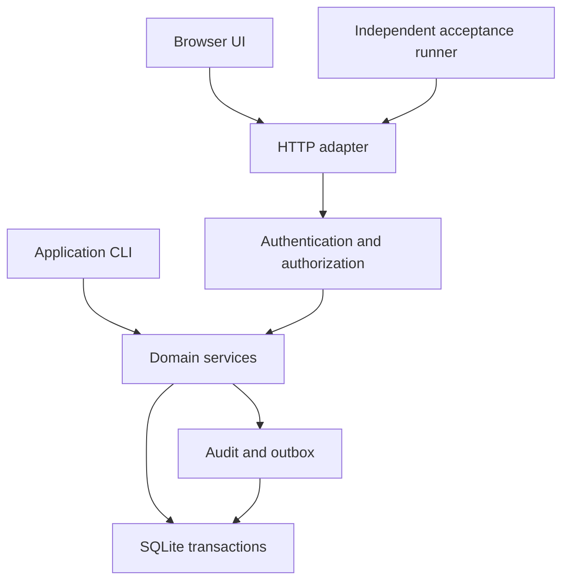

# Architecture

OpsLedger is a modular monolith: one Python package, one SQLite database, one
HTTP adapter. No framework in the baseline profile — no FastAPI, Django,
Flask, or ORM; standard-library Python 3.12 only.

## Layers

1. HTTP adapter (thin: routing, bounded JSON, error mapping)
2. Authentication and authorization
3. Domain services (business transactions, explicit identity context)
4. SQLite transactions / audit + transactional outbox

Dependencies point one way: services never import the HTTP adapter, and
handlers never contain business rules.

## Flow



## Layout

| Path | Responsibility |
| --- | --- |
| `opsledger/core/` | Errors, identity context, clock, IDs, database connections, migration runner |
| `opsledger/identity/` | Users, sessions, role checks, organization/site membership |
| `opsledger/assets/` | Sites, equipment, maintenance plans |
| `opsledger/workorders/` | State transitions, assignments, labor, checklists, comments |
| `opsledger/inventory/` | Parts, balances, reservations, movements, reconciliation |
| `opsledger/purchasing/` | Requests, approvals, purchase orders, receipts |
| `opsledger/incidents/` | Incidents, corrective actions, relationships to repairs |
| `opsledger/reporting/` | Authorized search, dashboards, CSV exports |
| `opsledger/audit/` | Append-only application audit and transactional outbox |
| `opsledger/http/` | Routing, bounded JSON, error mapping, cookie/CSRF handling, static allowlist |
| `opsledger/migrations/` | Append-only numbered SQL migrations with recorded checksums |
| `web/` | HTML, CSS, ES modules, no generated bundles |

All module directories are orientation for later tasks; the bootstrap ships
only `opsledger/__init__.py` and `opsledger/__main__.py`.

## Core foundation (T001)

### Error types (`opsledger/core/errors.py`)

All application errors derive from `ApplicationError(Exception)`:

- `ApplicationError(message, *, code=None, fields=None)` — base class with
  `code` (stable machine-readable string, default `"application_error"`),
  public `message` (via `str(error)`), and optional safe `fields` dict
  (field name -> public reason). `to_payload()` returns the public JSON
  envelope: `{"code", "message"}` plus `"fields"` when present.
- `ValidationError` — default code `validation_error`; caller input failed
  validation.
- `NotFoundError` — default code `not_found`; record missing in scope.
- `PermissionDeniedError` — default code `permission_denied`; caller lacks
  membership or role.
- `ConflictError` — default code `conflict`; request conflicts with current
  state.

Messages never contain tracebacks or internal details. Subclass codes may
be overridden per raise site (`NotFoundError("x", code="work_order_not_found")`).

### UTC clocks (`opsledger/core/clock.py`)

- `Clock` — protocol: `now() -> datetime` (timezone-aware UTC) and
  `timestamp() -> str` (second-precision RFC3339 ending in `Z`).
- `RealClock` — wall clock; always reports timezone-aware UTC.
- `FixedClock(instant)` — deterministic test clock; the instant is
  normalized to UTC and truncated to second precision, so repeated reads
  are identical.
- `format_rfc3339(value)` — serializes an aware datetime as
  `2026-01-01T00:00:00Z` (UTC, `Z` suffix, second precision).
- `require_aware_utc(value)` — returns `value` converted to UTC; rejects
  naive datetimes with `ValidationError` (`validation_error`).

Later business services take a `Clock` (injected; `FixedClock` in tests)
and serialize all stored timestamps through `format_rfc3339`.

## Persistence foundation (T002)

### SQLite connections (`opsledger/core/db.py`)

- `connect(path)` — opens a SQLite connection (a `sqlite3.Connection`
  subclass) to `path` with the OpsLedger profile: `foreign_keys=ON`,
  `journal_mode=WAL`, `synchronous=NORMAL`, and
  `row_factory=sqlite3.Row`. Connections are never shared across threads:
  use each connection on its creating thread only (`check_same_thread=True`
  is kept, so SQLite enforces this).
- `transaction(conn)` — context manager that runs a block inside one
  `BEGIN IMMEDIATE` transaction. On clean exit the transaction is
  committed; on any exception it is rolled back and the original error is
  re-raised. Nested use raises `ConflictError` with stable code
  `"conflict"` and a public message.

Usage:

```python
from opsledger.core.db import connect, transaction

conn = connect(path)
with transaction(conn) as tx:
    tx.execute("INSERT ...")
```

sqlite3 database errors (`IntegrityError`, `OperationalError`) propagate
unchanged from `transaction()` blocks: they are never swallowed and never
wrapped into application errors. All SQL is parameterized.

## Schema foundation (T003)

### Migration runner (`opsledger/core/migrations.py`)

Public interface — one function:

- `migrate(conn, directory, *, clock=None) -> list[str]` — applies pending
  SQL migrations from `directory` to the SQLite connection `conn` and
  returns the list of `migration_id` values applied in this call, in
  application order. Pass `clock` to make `applied_at` deterministic in
  tests; the real wall clock is used by default.

Runner behavior:

- Creates the `schema_migrations` history table when absent:
  `id` INTEGER PRIMARY KEY, `migration_id` TEXT NOT NULL UNIQUE,
  `checksum` TEXT NOT NULL, `applied_at` TEXT NOT NULL.
- Lists `*.sql` files in `directory` and sorts them by their numeric prefix
  (`NNN_name.sql`); a file without a numeric prefix raises
  `ValidationError` with the stable subclass code `validation_error`.
- Refuses changed applied files: loads the recorded history first, and if
  any already-applied migration's file content changed, raises
  `ConflictError` naming the `migration_id` before running anything —
  nothing is applied when any checksum mismatch exists (check all first,
  then apply).
- Applies each not-yet-applied migration inside one `transaction(conn)`
  block and records `(migration_id, checksum, applied_at)` in the same
  transaction, so schema statements and their history row commit or roll
  back together. `migration_id` is the filename without the `.sql` suffix;
  `checksum` is the sha256 hex digest of the exact file bytes.
- Skips already-applied migrations whose recorded checksum still matches
  the file's current checksum, so a second run is a no-op.

Conventions:

- Migration filenames are append-only numbered SQL files: `NNN_name.sql`.
  `applied_at` is RFC3339 UTC ending in `Z` with second precision.
- The history row for an applied migration is append-only: an applied
  migration's file must never change (SHA-256 makes tampering evident).
- Missing numbers are not errors and may not be backfilled by editing:
  `001` can be applied while `002` is absent; `002` applies when it
  reappears.
- `opsledger/migrations/` ships the runner fixture `0001_initial.sql`
  (creates the `schema_notes` table; not a business table) and the identity
  migration `0002_identity.sql` documented below.

Usage:

```python
from opsledger.core.migrations import migrate

migrate(conn, "opsledger/migrations")
```

## Identity schema (T004)

### Tables (`opsledger/migrations/0002_identity.sql`)

`organizations`:

| Column | Definition |
| --- | --- |
| `id` | TEXT PRIMARY KEY |
| `slug` | TEXT NOT NULL UNIQUE |
| `name` | TEXT NOT NULL |
| `created_at` | TEXT NOT NULL (RFC3339 UTC `Z`, second precision) |

`users`:

| Column | Definition |
| --- | --- |
| `id` | TEXT PRIMARY KEY |
| `email` | TEXT NOT NULL UNIQUE |
| `display_name` | TEXT NOT NULL |
| `created_at` | TEXT NOT NULL (RFC3339 UTC `Z`, second precision) |

`memberships`:

| Column | Definition |
| --- | --- |
| `organization_id` | TEXT NOT NULL REFERENCES `organizations(id)` |
| `user_id` | TEXT NOT NULL REFERENCES `users(id)` |
| `role` | TEXT NOT NULL CHECK (`role` IN `('developer','lead','auditor','approver','purchasing')`) |
| `created_at` | TEXT NOT NULL (RFC3339 UTC `Z`, second precision) |
| *(table)* | PRIMARY KEY (`organization_id`, `user_id`) — one row per organization+user |

### Normalization rule

Organization slugs and user emails are stored lowercase-trimmed. The
`CHECK` constraints (`slug = lower(trim(slug))`,
`email = lower(trim(email))`) reject any value that is not already in its
normalized form, so duplicate or different-case values collide on the
stored normalized value (UNIQUE) and are rejected with
`sqlite3.IntegrityError`. No table ever holds a non-normalized slug or
email; the future service layer normalizes input (lowercase, trimmed)
before the write.

### Membership key

The `(organization_id, user_id)` primary key means one membership row per
organization+user: the same user twice in one organization fails with
`sqlite3.IntegrityError`, while the same user in different organizations is
fine. Unknown role values are rejected by the `role` CHECK constraint, and
memberships referencing a missing organization or user fail the foreign
key (connections enforce `foreign_keys=ON`).

All statements are parameterized everywhere SQL carries values; created_at
values are RFC3339 UTC ending in `Z` with second precision.

## HTTP foundation (T005)

### Router (`opsledger/http/router.py`)

- `Router(*, body_limit_bytes=1048576)` — exact-path router. Configured
  limit bounds request bodies (default 1 MiB).
- `Router.add(path, methods, handler)` — registers `handler` for an exact
  `path` with the allowed method set (a single method or a list; case is
  normalized). Duplicate registration raises `RouterError`.
- `Router.dispatch(method, path)` — returns `(allow_header_or_None,
  matching_route_or_None)`; the transport layer turns a route-less result
  into 404 and an allow-header result into 405 with an ``Allow`` header.
- `Request` — frozen dataclass handed to route handlers: `method`, `path`,
  `headers`, `body` (raw bytes), `content_type` (lower-cased media type),
  `json` (parsed JSON payload, `None` when absent or malformed),
  `json_error` (`None` or an `InputError`). `json_or_error()` returns the
  payload or raises the parse error, so JSON `null` is distinguishable from
  a parse failure.
- `RouterServer(router, *, host="127.0.0.1", port=0, timeout=10)` — threading
  HTTP server. Binds `127.0.0.1` unless explicitly given another (valid)
  host. `serve_forever` runs on the caller's thread; `shutdown()` and
  `server_close()` stop it.

Route handlers receive the parsed `Request` and return `(status, body dict)`;
dict bodies are serialized as JSON responses.

### Error mapping (`opsledger/http/envelope.py`)

Every error response body is exactly:

    {"error": {"code": "<stable code>", "message": "<public message>",
               "request_id": "<opaque id>"}}

- `error_response_for(error, request_id)` — maps any raised error to
  `(http status, canonical envelope body)`.
- `http_status_for_error(error)` — maps a raised error to its HTTP status:
  `ValidationError` → 422, `NotFoundError` → 404, `PermissionDeniedError`
  → 403, `ConflictError` → 409, anything else → 500.
- `build_error_body(code, message, request_id)` — returns the canonical
  error envelope body (this shape, nothing more).
- `new_request_id()` — opaque correlation identifier per request.
- `InputError(status, code, message)` — bounded-input violation detected
  while parsing one request (for example malformed JSON or unsupported
  content type).
- Unexpected exceptions map to code `internal_error`, HTTP 500, public
  message `internal server error` — no traceback and no exception text in
  the response.
- Bounded input: bodies over the configured limit return 413 with code
  `body_too_large`; malformed JSON on JSON routes returns 400 with code
  `malformed_json`; a non-JSON content type on JSON routes returns 415 with
  code `unsupported_media_type`.

Router fixture route: `GET /api/v1/healthz` returns
`(200, {"status": "ok"})` (exercisable end to end; not the T006 readiness
handler).
