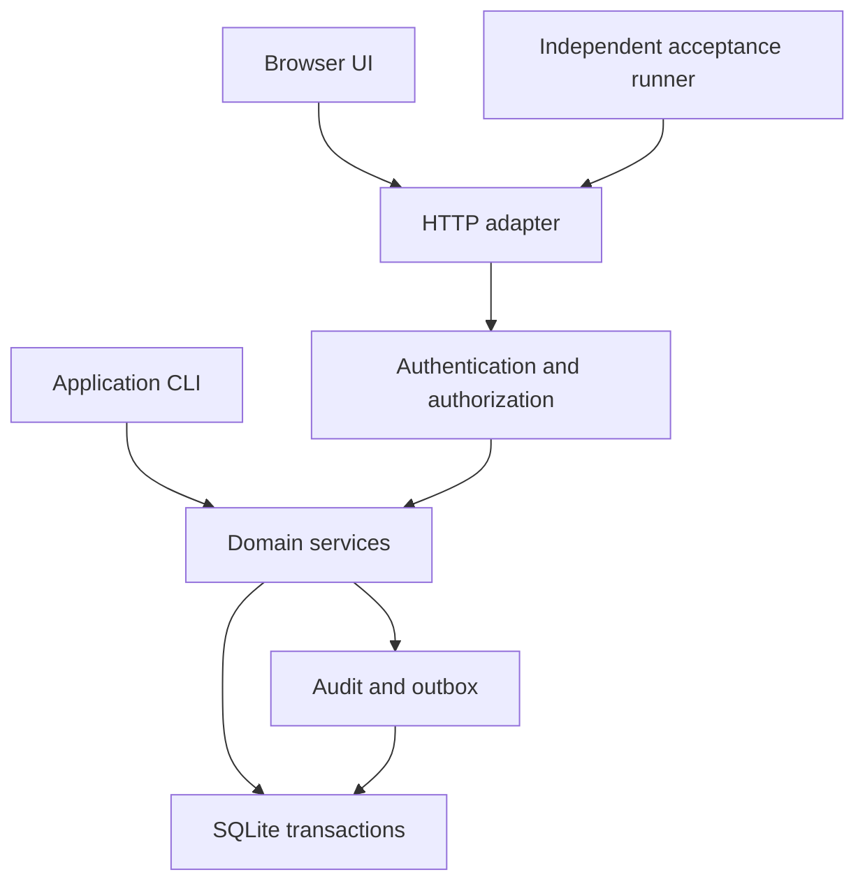

# Architecture

OpsLedger is a modular monolith: one Python package, one SQLite database, one
HTTP adapter. No framework in the baseline profile — no FastAPI, Django,
Flask, or ORM; standard-library Python 3.12 only.

## Layers

1. HTTP adapter (thin: routing, bounded JSON, error mapping)
2. Authentication and authorization
3. Domain services (business transactions, explicit identity context)
4. SQLite transactions / audit + transactional outbox

Dependencies point one way: services never import the HTTP adapter, and
handlers never contain business rules.

## Flow



## Layout

| Path | Responsibility |
| --- | --- |
| `opsledger/core/` | Errors, identity context, clock, IDs, database connections, migration runner |
| `opsledger/identity/` | Users, sessions, role checks, organization/site membership |
| `opsledger/assets/` | Sites, equipment, maintenance plans |
| `opsledger/workorders/` | State transitions, assignments, labor, checklists, comments |
| `opsledger/inventory/` | Parts, balances, reservations, movements, reconciliation |
| `opsledger/purchasing/` | Requests, approvals, purchase orders, receipts |
| `opsledger/incidents/` | Incidents, corrective actions, relationships to repairs |
| `opsledger/reporting/` | Authorized search, dashboards, CSV exports |
| `opsledger/audit/` | Append-only application audit and transactional outbox |
| `opsledger/http/` | Routing, bounded JSON, error mapping, cookie/CSRF handling, static allowlist |
| `opsledger/migrations/` | Append-only numbered SQL migrations with recorded checksums |
| `web/` | HTML, CSS, ES modules, no generated bundles |

All module directories are orientation for later tasks; the bootstrap ships
only `opsledger/__init__.py` and `opsledger/__main__.py`.

## Core foundation (T001)

### Error types (`opsledger/core/errors.py`)

All application errors derive from `ApplicationError(Exception)`:

- `ApplicationError(message, *, code=None, fields=None)` — base class with
  `code` (stable machine-readable string, default `"application_error"`),
  public `message` (via `str(error)`), and optional safe `fields` dict
  (field name -> public reason). `to_payload()` returns the public JSON
  envelope: `{"code", "message"}` plus `"fields"` when present.
- `ValidationError` — default code `validation_error`; caller input failed
  validation.
- `NotFoundError` — default code `not_found`; record missing in scope.
- `PermissionDeniedError` — default code `permission_denied`; caller lacks
  membership or role.
- `ConflictError` — default code `conflict`; request conflicts with current
  state.

Messages never contain tracebacks or internal details. Subclass codes may
be overridden per raise site (`NotFoundError("x", code="work_order_not_found")`).

### UTC clocks (`opsledger/core/clock.py`)

- `Clock` — protocol: `now() -> datetime` (timezone-aware UTC) and
  `timestamp() -> str` (second-precision RFC3339 ending in `Z`).
- `RealClock` — wall clock; always reports timezone-aware UTC.
- `FixedClock(instant)` — deterministic test clock; the instant is
  normalized to UTC and truncated to second precision, so repeated reads
  are identical.
- `format_rfc3339(value)` — serializes an aware datetime as
  `2026-01-01T00:00:00Z` (UTC, `Z` suffix, second precision).
- `require_aware_utc(value)` — returns `value` converted to UTC; rejects
  naive datetimes with `ValidationError` (`validation_error`).

Later business services take a `Clock` (injected; `FixedClock` in tests)
and serialize all stored timestamps through `format_rfc3339`.

## Persistence foundation (T002)

### SQLite connections (`opsledger/core/db.py`)

- `connect(path)` — opens a SQLite connection (a `sqlite3.Connection`
  subclass) to `path` with the OpsLedger profile: `foreign_keys=ON`,
  `journal_mode=WAL`, `synchronous=NORMAL`, and
  `row_factory=sqlite3.Row`. Connections are never shared across threads:
  use each connection on its creating thread only (`check_same_thread=True`
  is kept, so SQLite enforces this).
- `transaction(conn)` — context manager that runs a block inside one
  `BEGIN IMMEDIATE` transaction. On clean exit the transaction is
  committed; on any exception it is rolled back and the original error is
  re-raised. Nested use raises `ConflictError` with stable code
  `"conflict"` and a public message.

Usage:

```python
from opsledger.core.db import connect, transaction

conn = connect(path)
with transaction(conn) as tx:
    tx.execute("INSERT ...")
```

sqlite3 database errors (`IntegrityError`, `OperationalError`) propagate
unchanged from `transaction()` blocks: they are never swallowed and never
wrapped into application errors. All SQL is parameterized.
