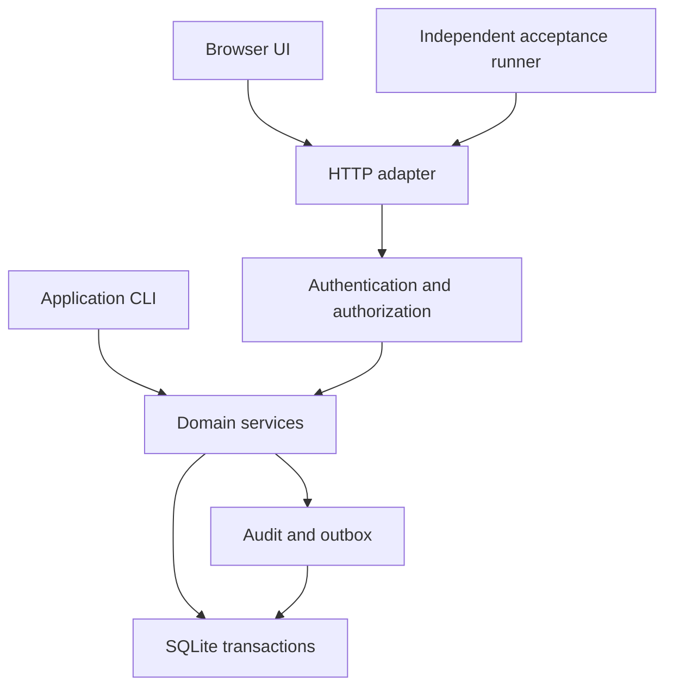

# Architecture

OpsLedger is a modular monolith: one Python package, one SQLite database, one
HTTP adapter. No framework in the baseline profile — no FastAPI, Django,
Flask, or ORM; standard-library Python 3.12 only.

## Layers

1. HTTP adapter (thin: routing, bounded JSON, error mapping)
2. Authentication and authorization
3. Domain services (business transactions, explicit identity context)
4. SQLite transactions / audit + transactional outbox

Dependencies point one way: services never import the HTTP adapter, and
handlers never contain business rules.

## Flow



## Layout

| Path | Responsibility |
| --- | --- |
| `opsledger/core/` | Errors, identity context, clock, IDs, database connections, migration runner |
| `opsledger/identity/` | Password hashes, users, sessions, role checks, organization/site membership |
| `opsledger/assets/` | Sites, equipment, maintenance plans |
| `opsledger/workorders/` | State transitions, assignments, labor, checklists, comments |
| `opsledger/inventory/` | Parts, balances, reservations, movements, reconciliation |
| `opsledger/purchasing/` | Requests, approvals, purchase orders, receipts |
| `opsledger/incidents/` | Incidents, corrective actions, relationships to repairs |
| `opsledger/reporting/` | Authorized search, dashboards, CSV exports |
| `opsledger/audit/` | Append-only application audit and transactional outbox |
| `opsledger/http/` | Routing, bounded JSON, error mapping, cookie/CSRF handling, static allowlist |
| `opsledger/migrations/` | Append-only numbered SQL migrations with recorded checksums |
| `web/` | HTML, CSS, ES modules, no generated bundles |

All module directories are orientation for later tasks; the bootstrap ships
`opsledger/__init__.py` and `opsledger/__main__.py`, with `opsledger/core/`,
`opsledger/http/`, and `opsledger/migrations/` landing through DevFoundry
tasks (T001–T006).

## Core foundation (T001)

### Error types (`opsledger/core/errors.py`)

All application errors derive from `ApplicationError(Exception)`:

- `ApplicationError(message, *, code=None, fields=None)` — base class with
  `code` (stable machine-readable string, default `"application_error"`),
  public `message` (via `str(error)`), and optional safe `fields` dict
  (field name -> public reason). `to_payload()` returns the public JSON
  envelope: `{"code", "message"}` plus `"fields"` when present.
- `ValidationError` — default code `validation_error`; caller input failed
  validation.
- `NotFoundError` — default code `not_found`; record missing in scope.
- `PermissionDeniedError` — default code `permission_denied`; caller lacks
  membership or role.
- `ConflictError` — default code `conflict`; request conflicts with current
  state.

Messages never contain tracebacks or internal details. Subclass codes may
be overridden per raise site (`NotFoundError("x", code="work_order_not_found")`).

### UTC clocks (`opsledger/core/clock.py`)

- `Clock` — protocol: `now() -> datetime` (timezone-aware UTC) and
  `timestamp() -> str` (second-precision RFC3339 ending in `Z`).
- `RealClock` — wall clock; always reports timezone-aware UTC.
- `FixedClock(instant)` — deterministic test clock; the instant is
  normalized to UTC and truncated to second precision, so repeated reads
  are identical.
- `format_rfc3339(value)` — serializes an aware datetime as
  `2026-01-01T00:00:00Z` (UTC, `Z` suffix, second precision).
- `require_aware_utc(value)` — returns `value` converted to UTC; rejects
  naive datetimes with `ValidationError` (`validation_error`).

Later business services take a `Clock` (injected; `FixedClock` in tests)
and serialize all stored timestamps through `format_rfc3339`.

## Persistence foundation (T002)

### SQLite connections (`opsledger/core/db.py`)

- `connect(path)` — opens a SQLite connection (a `sqlite3.Connection`
  subclass) to `path` with the OpsLedger profile: `foreign_keys=ON`,
  `journal_mode=WAL`, `synchronous=NORMAL`, and
  `row_factory=sqlite3.Row`. Connections are never shared across threads:
  use each connection on its creating thread only (`check_same_thread=True`
  is kept, so SQLite enforces this).
- `transaction(conn)` — context manager that runs a block inside one
  `BEGIN IMMEDIATE` transaction. On clean exit the transaction is
  committed; on any exception it is rolled back and the original error is
  re-raised. Nested use raises `ConflictError` with stable code
  `"conflict"` and a public message.

Usage:

```python
from opsledger.core.db import connect, transaction

conn = connect(path)
with transaction(conn) as tx:
    tx.execute("INSERT ...")
```

sqlite3 database errors (`IntegrityError`, `OperationalError`) propagate
unchanged from `transaction()` blocks: they are never swallowed and never
wrapped into application errors. All SQL is parameterized.

## Schema foundation (T003)

### Migration runner (`opsledger/core/migrations.py`)

Public interface — one function:

- `migrate(conn, directory, *, clock=None) -> list[str]` — applies pending
  SQL migrations from `directory` to the SQLite connection `conn` and
  returns the list of `migration_id` values applied in this call, in
  application order. Pass `clock` to make `applied_at` deterministic in
  tests; the real wall clock is used by default.

Runner behavior:

- Creates the `schema_migrations` history table when absent:
  `id` INTEGER PRIMARY KEY, `migration_id` TEXT NOT NULL UNIQUE,
  `checksum` TEXT NOT NULL, `applied_at` TEXT NOT NULL.
- Lists `*.sql` files in `directory` and sorts them by their numeric prefix
  (`NNN_name.sql`); a file without a numeric prefix raises
  `ValidationError` with the stable subclass code `validation_error`.
- Refuses changed applied files: loads the recorded history first, and if
  any already-applied migration's file content changed, raises
  `ConflictError` naming the `migration_id` before running anything —
  nothing is applied when any checksum mismatch exists (check all first,
  then apply).
- Applies each not-yet-applied migration inside one `transaction(conn)`
  block and records `(migration_id, checksum, applied_at)` in the same
  transaction, so schema statements and their history row commit or roll
  back together. `migration_id` is the filename without the `.sql` suffix;
  `checksum` is the sha256 hex digest of the exact file bytes.
- Skips already-applied migrations whose recorded checksum still matches
  the file's current checksum, so a second run is a no-op.

Conventions:

- Migration filenames are append-only numbered SQL files: `NNN_name.sql`.
  `applied_at` is RFC3339 UTC ending in `Z` with second precision.
- The history row for an applied migration is append-only: an applied
  migration's file must never change (SHA-256 makes tampering evident).
- Missing numbers are not errors and may not be backfilled by editing:
  `001` can be applied while `002` is absent; `002` applies when it
  reappears.
- `opsledger/migrations/` ships the runner fixture `0001_initial.sql`
  (creates the `schema_notes` table; not a business table) and the identity
  migration `0002_identity.sql` documented below.

Usage:

```python
from opsledger.core.migrations import migrate

migrate(conn, "opsledger/migrations")
```

## Identity schema (T004)

### Tables (`opsledger/migrations/0002_identity.sql`)

`organizations`:

| Column | Definition |
| --- | --- |
| `id` | TEXT PRIMARY KEY |
| `slug` | TEXT NOT NULL UNIQUE |
| `name` | TEXT NOT NULL |
| `created_at` | TEXT NOT NULL (RFC3339 UTC `Z`, second precision) |

`users`:

| Column | Definition |
| --- | --- |
| `id` | TEXT PRIMARY KEY |
| `email` | TEXT NOT NULL UNIQUE |
| `display_name` | TEXT NOT NULL |
| `created_at` | TEXT NOT NULL (RFC3339 UTC `Z`, second precision) |

`memberships`:

| Column | Definition |
| --- | --- |
| `organization_id` | TEXT NOT NULL REFERENCES `organizations(id)` |
| `user_id` | TEXT NOT NULL REFERENCES `users(id)` |
| `role` | TEXT NOT NULL CHECK (`role` IN `('developer','lead','auditor','approver','purchasing')`) |
| `created_at` | TEXT NOT NULL (RFC3339 UTC `Z`, second precision) |
| *(table)* | PRIMARY KEY (`organization_id`, `user_id`) — one row per organization+user |

### Normalization rule

Organization slugs and user emails are stored lowercase-trimmed. The
`CHECK` constraints (`slug = lower(trim(slug))`,
`email = lower(trim(email))`) reject any value that is not already in its
normalized form, so duplicate or different-case values collide on the
stored normalized value (UNIQUE) and are rejected with
`sqlite3.IntegrityError`. No table ever holds a non-normalized slug or
email; the future service layer normalizes input (lowercase, trimmed)
before the write.

### Membership key

The `(organization_id, user_id)` primary key means one membership row per
organization+user: the same user twice in one organization fails with
`sqlite3.IntegrityError`, while the same user in different organizations is
fine. Unknown role values are rejected by the `role` CHECK constraint, and
memberships referencing a missing organization or user fail the foreign
key (connections enforce `foreign_keys=ON`).

All statements are parameterized everywhere SQL carries values; created_at
values are RFC3339 UTC ending in `Z` with second precision.

## Identity: password hashes (T009)

### Module (`opsledger/identity/passwords.py`)

Public names (exported from `opsledger/identity/`):

- `PROTOCOL_VERSION = 1` — recorded with every hash record.
- `SCRYPT_N = 16384`, `SCRYPT_R = 8`, `SCRYPT_P = 1` — the shipped work
  factors, also the defaults of `ScryptParams`.
- `hash_password(password, *, params=None, clock=None, rng=None)` — returns
  one `PasswordHash`; the raw password is never stored, logged, or returned.
- `verify_password(password, record)` — constant-time verification.
- `to_row(record)` / `from_row(row)` — mapping between a record and the
  users-provisioning row shape for the offline provisioning path.
- `provision_user(conn, *, user_id, email, display_name, password,
  clock=None, rng=None)` — inserts the user row with the hash columns.
- `scrypt_unavailable()` — preflight; True when `hashlib.scrypt` raises
  `ValueError` (OpenSSL without scrypt).

### Record shape (`PasswordHash`, frozen; `ScryptParams`, frozen)

| Field | Content |
| --- | --- |
| `user_id` | User identity this record belongs to (blank on `hash_password`; set by `provision_user`) |
| `salt` | 16 random bytes from `secrets.token_bytes`, hex-encoded (128-bit salt, 32 hex chars) |
| `hash` | 64-byte derived key from `hashlib.scrypt(password.encode("utf-8"), salt=..., n/r/p from params, dklen=64)`, hex-encoded (128 hex chars) |
| `params` | `ScryptParams(n, r, p)` pinned and recorded with the hash |
| `protocol_version` | `PROTOCOL_VERSION` (1), recorded with the hash |
| `created_at` | RFC3339 UTC `Z` second-precision text via `opsledger.core.clock.format_rfc3339` (injected `Clock`; real wall clock by default) |

### Scrypt work factors and their rationale

`n = 2**14 = 16384`, `r = 8`, `p = 1` (constants `SCRYPT_N`/`SCRYPT_R`/
`SCRYPT_P`, never tuned at raise sites):

- `n = 16384` — ~16 MiB of memory per derivation (scrypt needs roughly
  `128 * n * r` bytes), strong against GPU/ASIC cracking while a login
  stays in the documented runtime budget.
- `r = 8` — the scrypt reference value; the standard pairing with `n` that
  parallelizes memory access without weakening it.
- `p = 1` — no CPU-side parallelism multiplier; keeps the derivation single
  work unit, so the memory cost is the dominant defense.
- `dklen = 64` — 64-byte derived key, stored as 128 hex chars; no truncation
  of scrypt output.

Validation rejects `n <= 1` or not a power of two, and `r < 1` or `p < 1`,
with `ValidationError`. Two hashes of the same password always differ
(random salt), so hashes are not linkable and precomputed tables are
useless. A fast unsalted hash is never used.

### Protocol-version rule

Every hash record pins `protocol_version` (1). Recomputation only accepts
records whose `protocol_version` equals `PROTOCOL_VERSION`; a record with
any other value (a future format written by newer code, or a corrupted
version field) raises `ValidationError` on `verify_password` instead of
comparing against a recomputed key of unknown meaning. A future protocol
version bumps `PROTOCOL_VERSION`, keeps the old verifier reading old
records, and migrates records forward; hex fields are validated before use,
so malformed fields raise `ValidationError` too.

### Offline-provisioning path

`provision_user(conn, ...)` is the offline path for creating a user with
credentials (no sessions, no login, no HTTP endpoint, no UI — those are
later tasks):

1. Validates the input: `user_id` and `display_name` non-empty strings; the
   email is normalized with `.strip().lower()` and validated as a simple
   local@domain shape (one `@`, non-empty parts) — violations raise
   `ValidationError`.
2. Preflights scrypt: with scrypt unavailable, provisioning raises
   `ValidationError` before hashing and never stores a row.
3. Derives the hash record via `hash_password` with the injected clock/rng.
4. Inserts the user row (identity columns plus the hash columns) inside
   `opsledger.core.db.transaction(conn)`, in one IMMEDIATE transaction —
   the user and its hash columns commit or roll back together. A duplicate
   email surfaces `sqlite3.IntegrityError` as `ValidationError`, and the
   duplicate is never stored raw.
5. Returns the stored `PasswordHash` with `user_id` set.

`to_row(record)` maps the record onto this row shape (identity columns blank
for the record-only case; callers fill `email`/`display_name` before the
write), and `from_row(row)` maps back. Parameterized SQL for list/get
paths stays in later tasks; all SQL here carries values only as bound
parameters.

## Identity: sessions storage (T010 part B)

### Migration (`opsledger/migrations/0003_sessions.sql`)

Third shipped append-only migration, applied after `0002_identity`. It
creates the `sessions` table:

    CREATE TABLE sessions (
        token_hash TEXT PRIMARY KEY,
        user_id TEXT NOT NULL REFERENCES users(id),
        created_at TEXT NOT NULL,
        expires_at TEXT NOT NULL,
        revoked_at TEXT
    );

The migration is checksum-recorded by the migration runner: its sha256
digest of the exact file bytes is written into `schema_migrations` in the
same IMMEDIATE transaction as the DDL, so any later change to the file
bytes is tamper-evident.

### Table shape

| Column | Content |
| --- | --- |
| `token_hash` | Primary key; the sha256 hex digest of the raw session token |
| `user_id` | Owner identity, `REFERENCES users(id)` |
| `created_at` | RFC3339 UTC `Z` second-precision creation text |
| `expires_at` | RFC3339 UTC `Z` second-precision expiry text |
| `revoked_at` | Null while active; revocation timestamp when revoked |

### Token storage rule

Only the sha256 token hash is stored. The raw token is shown once at
creation (returned by `create_session`) and never persisted — not in this
table, not in the audit, not in logs — so a database leak cannot be replayed
as a session.

### Expiry and revocation semantics

- `verify_session(token)` looks up the row by the token's sha256 hash and
  returns the session only when `revoked_at` is null and `expires_at` is in
  the future; an expired or revoked session fails verification.
- `revoke_session(token)` stamps `revoked_at`; a revoked session never
  verifies again.
- Logout is revocation: ending a session calls `revoke_session`, and the
  revocation timestamp is persisted (audit trail stays append-only).

## Identity: CSRF contexts storage (T011 part B)

### Migration (`opsledger/migrations/0004_csrf_contexts.sql`)

Fourth shipped append-only migration, applied after `0003_sessions`. It
creates the `csrf_contexts` table:

    CREATE TABLE csrf_contexts (
        token_hash TEXT PRIMARY KEY,
        created_at TEXT NOT NULL,
        expires_at TEXT NOT NULL,
        rotated_at TEXT
    );

The migration is checksum-recorded by the migration runner: its sha256
digest of the exact file bytes is written into `schema_migrations` in the
same IMMEDIATE transaction as the DDL, so any later change to the file
bytes is tamper-evident.

### Table shape

| Column | Content |
| --- | --- |
| `token_hash` | Primary key; the sha256 hex digest of the raw CSRF token |
| `created_at` | RFC3339 UTC `Z` second-precision creation text |
| `expires_at` | RFC3339 UTC `Z` second-precision expiry text |
| `rotated_at` | Null while current; timestamp when the context was rotated/superseded |

### Token storage rule

Only the sha256 token hash is stored. The raw CSRF token is delivered once
at issue time (returned by `issue_context`) and never persisted — not in
this table, not in the audit, not in logs — so a database leak cannot be
used to build a CSRF token.

### TTL

CSRF contexts have a short TTL: default 900 s, maximum 3600 s. An expired
context fails verification.

### Rotation semantics

- `rotate_context` issues a fresh context (new token, new expiry) in place
  of the old one.
- `supersede` marks the old context rotated (stamps `rotated_at`) so its
  raw token stops verifying.

### Router (`opsledger/http/router.py`)

- `Router(*, body_limit_bytes=1048576)` — exact-path router. Configured
  limit bounds request bodies (default 1 MiB).
- `Router.add(path, methods, handler)` — registers `handler` for an exact
  `path` with the allowed method set (a single method or a list; case is
  normalized). Duplicate registration raises `RouterError`.
- `Router.dispatch(method, path)` — returns `(allow_header_or_None,
  matching_route_or_None)`; the transport layer turns a route-less result
  into 404 and an allow-header result into 405 with an ``Allow`` header.
- `Request` — frozen dataclass handed to route handlers: `method`, `path`,
  `headers`, `body` (raw bytes), `content_type` (lower-cased media type),
  `json` (parsed JSON payload, `None` when absent or malformed),
  `json_error` (`None` or an `InputError`). `json_or_error()` returns the
  payload or raises the parse error, so JSON `null` is distinguishable from
  a parse failure.
- `RouterServer(router, *, host="127.0.0.1", port=0, timeout=10)` — threading
  HTTP server. Binds `127.0.0.1` unless explicitly given another (valid)
  host. `serve_forever` runs on the caller's thread; `shutdown()` and
  `server_close()` stop it.

Route handlers receive the parsed `Request` and return `(status, body dict)`;
dict bodies are serialized as JSON responses.

## Identity: site memberships storage (T014 part B)

### Migration (`opsledger/migrations/0006_site_memberships.sql`)

Sixth shipped append-only migration, applied after `0005_user_hash_columns`.
It creates the `site_memberships` table:

    CREATE TABLE site_memberships (
        organization_id TEXT NOT NULL REFERENCES organizations(id),
        site_id TEXT NOT NULL,
        user_id TEXT NOT NULL REFERENCES users(id),
        granted_at TEXT NOT NULL,
        revoked_at TEXT,
        PRIMARY KEY (organization_id, site_id, user_id)
    );

The migration is checksum-recorded by the migration runner: its sha256
digest of the exact file bytes is written into `schema_migrations` in the
same IMMEDIATE transaction as the DDL, so any later change to the file
bytes is tamper-evident.

### Table shape

Composite primary key: (`organization_id`, `site_id`, `user_id`).

| Column | Content |
| --- | --- |
| `organization_id` | Part of the composite PK; references `organizations(id)` |
| `site_id` | Part of the composite PK; the site within the organization |
| `user_id` | Part of the composite PK; references `users(id)` |
| `granted_at` | RFC3339 UTC `Z` second-precision grant text |
| `revoked_at` | Null while active; revocation timestamp when the membership was revoked |

### Revocation semantics

Revocation stamps `revoked_at`. There is no caching: every access check
(`require_site_access` / `has_site_access`) reads `revoked_at IS NULL` on
every call, so revocation takes effect immediately and existing sessions
lose access to the site on revocation.

### Deactivation semantics

`deactivate_membership` deletes the memberships row, which takes effect
immediately for subsequent access checks.

## Locations: sites storage (T017 part B)

### Migration (`opsledger/migrations/0007_sites.sql`)

Seventh shipped append-only migration, applied after
`0006_site_memberships`. It creates the `sites` table:

    CREATE TABLE sites (
        id TEXT PRIMARY KEY,
        organization_id TEXT NOT NULL REFERENCES organizations(id),
        code TEXT NOT NULL,
        name TEXT NOT NULL,
        timezone TEXT NOT NULL DEFAULT 'UTC',
        created_at TEXT NOT NULL,
        archived_at TEXT,
        UNIQUE (organization_id, code)
    );

The migration is checksum-recorded by the migration runner: its sha256
digest of the exact file bytes is written into `schema_migrations` in the
same IMMEDIATE transaction as the DDL, so any later change to the file
bytes is tamper-evident.

### Table shape

Primary key: `id` (opaque `site-<hex>` id, immutable after create).

| Column | Content |
| --- | --- |
| `id` | Primary key; opaque site identifier |
| `organization_id` | References `organizations(id)`; the owning organization |
| `code` | Site code within the organization; immutable after create |
| `name` | Display name (updates may touch this) |
| `timezone` | IANA timezone name, `UTC` by default (updates may touch this) |
| `created_at` | RFC3339 UTC `Z` second-precision creation text |
| `archived_at` | Null while active; archive timestamp when the site is archived |

### Scoped uniqueness

`UNIQUE (organization_id, code)` is the scoping rule: the same code is
allowed in another organization, and a duplicate within the same
organization collides. The service maps that `IntegrityError` to
`ConflictError` with the canonical message
`site code already exists in this organization`.

### Update semantics

`update_site` touches `name` and `timezone` only. `code` is immutable
after creation: there is no code update path in the module. Every lookup
is scoped by `require_owned`, so a missing site and another
organization's site surface the identical `site not found` error.

## Equipment: assets storage (T018 part B)

### Migration (`opsledger/migrations/0008_assets.sql`)

Eighth shipped append-only migration, applied after `0007_sites`. It adds a
unique index on `sites` and creates the `assets` table:

    CREATE UNIQUE INDEX sites_org_id_idx ON sites (organization_id, id);

    CREATE TABLE assets (
        id TEXT PRIMARY KEY,
        organization_id TEXT NOT NULL REFERENCES organizations(id),
        site_id TEXT NOT NULL,
        tag TEXT NOT NULL,
        name TEXT NOT NULL,
        criticality TEXT NOT NULL CHECK (criticality IN ('low','medium','high')),
        purchase_cost_cents INTEGER NOT NULL CHECK (purchase_cost_cents >= 0),
        version INTEGER NOT NULL CHECK (version > 0),
        created_at TEXT NOT NULL,
        updated_at TEXT NOT NULL,
        archived_at TEXT,
        UNIQUE (organization_id, tag),
        FOREIGN KEY (organization_id, site_id) REFERENCES sites (organization_id, id)
    );

The migration is checksum-recorded by the migration runner: its sha256
digest of the exact file bytes is written into `schema_migrations`, so any
later change to the file bytes is tamper-evident.

### Table shape

Primary key: `id` (opaque `ast-<hex>` id, immutable after create).

| Column | Content |
| --- | --- |
| `id` | Primary key; opaque asset identifier |
| `organization_id` | References `organizations(id)`; the owning organization |
| `site_id` | Site the asset belongs to; part of the composite foreign key |
| `tag` | Asset tag within the organization; unique per organization |
| `name` | Display name |
| `criticality` | One of: low, medium, high (CHECK) |
| `purchase_cost_cents` | Purchase cost in integer cents, CHECK `>= 0` |
| `version` | Positive integer version, CHECK `> 0` |
| `created_at` | RFC3339 UTC `Z` second-precision creation text |
| `updated_at` | RFC3339 UTC `Z` second-precision update text |
| `archived_at` | Null while active; archive timestamp when archived |

### Database-level site scoping

The composite foreign key `(organization_id, site_id) -> sites
(organization_id, id)` is the database-level scoping rule: an asset row's
`(organization_id, site_id)` must match a site row's `(organization_id,
id)`, so a cross-organization site reference violates the FK and is
impossible to store. The unique index `sites_org_id_idx` on `sites
(organization_id, id)` backs this composite foreign key. The service-level
path (`scoped_first` + `require_owned` in `opsledger/assets/sites.py` +
`assets.py`, commit 0545801) makes a cross-organization site
indistinguishable from a missing site (`site not found`); the database
level makes it impossible to store even if written directly.

### Scoped uniqueness and money

`UNIQUE (organization_id, tag)` is the scoping rule: the same tag is
allowed in another organization, and a duplicate within the same
organization collides. The service maps that `IntegrityError` to
`ConflictError` with the canonical message
`asset tag already exists in this organization`. Money is stored as
integer cents (no floats, no rounding): `purchase_cost_cents` with CHECK
`>= 0`.

### Error mapping (`opsledger/http/envelope.py`)

Every error response body is exactly:

    {"error": {"code": "<stable code>", "message": "<public message>",
               "request_id": "<opaque id>"}}

- `error_response_for(error, request_id)` — maps any raised error to
  `(http status, canonical envelope body)`.
- `http_status_for_error(error)` — maps a raised error to its HTTP status:
  `ValidationError` → 422, `NotFoundError` → 404, `PermissionDeniedError`
  → 403, `ConflictError` → 409, anything else → 500.
- `build_error_body(code, message, request_id)` — returns the canonical
  error envelope body (this shape, nothing more).
- `new_request_id()` — opaque correlation identifier per request.
- `InputError(status, code, message)` — bounded-input violation detected
  while parsing one request (for example malformed JSON or unsupported
  content type).
- Unexpected exceptions map to code `internal_error`, HTTP 500, public
  message `internal server error` — no traceback and no exception text in
  the response.
- Bounded input: bodies over the configured limit return 413 with code
  `body_too_large`; malformed JSON on JSON routes returns 400 with code
  `malformed_json`; a non-JSON content type on JSON routes returns 415 with
  code `unsupported_media_type`.

Router fixture route: `GET /api/v1/healthz` returns
`(200, {"status": "ok"})` (exercisable end to end; not the T006 readiness
handler).

## CLI and diagnostics (T006)

### Application CLI (`opsledger/cli.py`)

Stdlib argparse with two subcommands, runnable via
`python -m opsledger.cli`:

- `migrate DATABASE [--migrations DIR]` — connects to `DATABASE` with
  `opsledger.core.db.connect`, runs
  `opsledger.core.migrations.migrate(conn, dir)`, prints each applied
  `migration_id` one per line, exits 0. `DIR` defaults to
  `opsledger/migrations`.
- `serve DATABASE [--host H] [--port P]` — runs migrations first (same
  rules as `migrate`), builds the diagnostics router
  (`opsledger.http.handlers.build_router()`), and serves with
  `RouterServer` until SIGINT/SIGTERM. Defaults `127.0.0.1` / `8080`.
  Shutdown is `shutdown()` + `server_close()` and a clean exit 0.

Exit codes:

| Exit | Meaning |
| --- | --- |
| 0 | Success (migrations applied / no-op, or server shut down cleanly) |
| 1 | `ConflictError` / `ValidationError`: the public message is printed to stderr (never a traceback) |

No paths, SQL, secrets, or traceback text are ever printed.

### Diagnostics responses (`opsledger/http/handlers.py`)

Router built by `build_router()`:

- `GET /api/v1/healthz` -> `healthz_handler`
- `GET /api/v1/readyz` -> `readyz_handler`

The liveness body is exactly:

    {"status": "ok"}

The readiness handler reads the database the router server was configured
with (schema_migrations history) and returns exactly one of:

- missing or empty history, or recorded history missing a shipped
  migration (first five missing ids sorted):

      {"error": {"code": "unready", "message": "the schema has not been migrated", "request_id": "<opaque id>"}}

  (the missing-ids variant appends `: missing <id>, <id>` to the message;
  503 status);
- otherwise (200):

      {"status": "ready", "migrations": N}

Responses are bounded and never contain paths, SQL, secrets, or traceback
text. Unexpected errors inside readyz go through `error_response_for`
(500 `internal_error`, public message `internal server error`, no
exception details). The readyz target is set via
`configure_readyz(database_path)` (also available through
`build_router(database_path=...)`); tests clear it with `configure_readyz(None)`.

## Authorization matrix (T016)

Gate rule (spec §7.3/M2 gate, T016): "Every declared role/action pair has
observed or explicitly pending evidence." Roles come from
`opsledger.identity.permissions` (`KNOWN_ROLES` + `BASE_PERMISSIONS` +
`PURCHASE_APPROVE_PERMISSION`); actions are the base-permission strings plus
the explicit approver grant. Verdicts below are observed at the domain layer
by `tests/security/test_authorization_matrix.py` (A = allow, D = deny).
Pairs not yet enforced by HTTP routes are "explicitly pending": HTTP-route
enforcement lands with M3+ tasks.

### Role x action verdicts

| Action | admin | supervisor | technician | purchasing | auditor |
| --- | --- | --- | --- | --- | --- |
| `asset.write` | A | A | D | D | D |
| `audit.read` | A | D | D | D | A |
| `export.read` | D | D | D | D | A |
| `inventory.adjust` | A | A | D | D | D |
| `inventory.reserve` | D | D | A | D | D |
| `inventory.write` | A | D | D | D | D |
| `org.manage_members` | A | D | D | D | D |
| `org.manage_sites` | A | D | D | D | D |
| `purchase.approve` (no explicit grant) | D | D | D | D | D |
| `purchase.approve` (with explicit grant) | A | A | A | A | A |
| self-approval (actor_id == target_user_id) | D | D | D | D | D |
| `purchasing.write` | A | D | D | A | D |
| `reporting.read` | A | A | A | A | A |
| `workorder.close` | A | A | D | D | D |
| `workorder.work` | D | D | A | D | D |

### Auditor read-only rule

For every permission in `effective_permissions("auditor")`, the permission
contains `.read` or `.export`; no permission containing `.write`, `.adjust`,
`.approve`, `.reserve`, `.consume`, or `workorder.work` is held.
`has_permission(auditor, each write-shaped action)` is False.

### Approver-grant rule

`purchase.approve` is in NO role's base set. A purchasing context with
`explicit_grants=["purchase.approve"]` holds it; a purchasing context
without the grant does not. The same applies to supervisor. A technician
without the grant is denied.

### Self-approval rule

`assert_not_self_approval` raises `PermissionDeniedError` for every role
(all five roles) when `context.actor_id == target_user_id` — including
admin — and passes for a different target.

### HTTP-route enforcement (explicitly pending evidence)

HTTP-route enforcement of the matrix above lands with M3+ tasks
(explicitly pending evidence).
