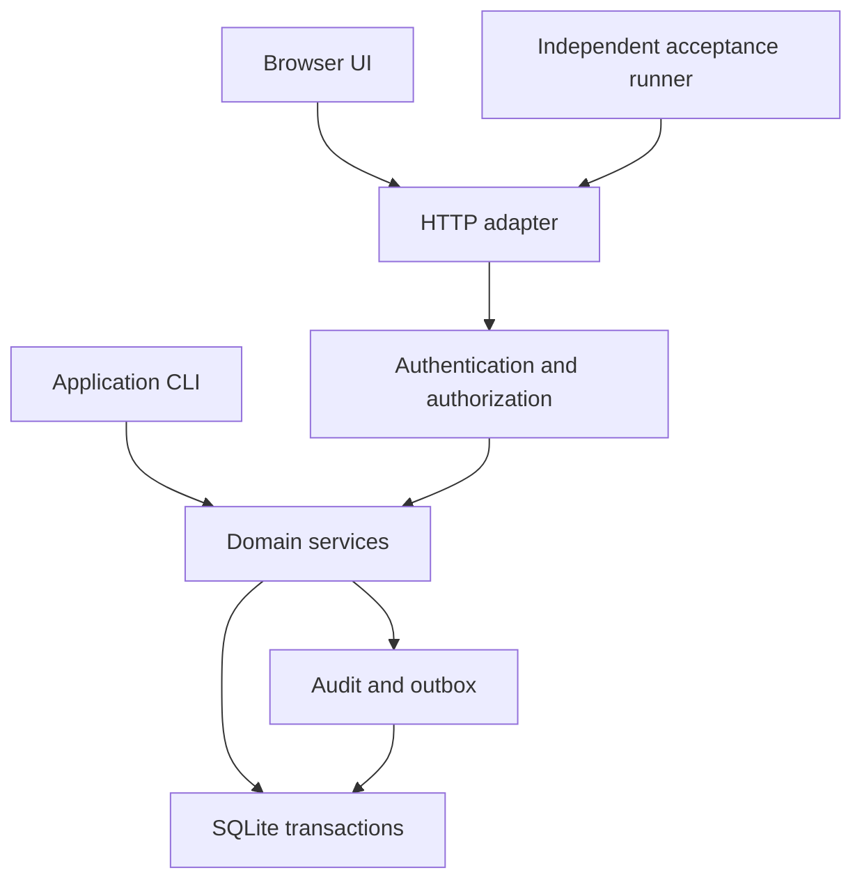

# Architecture

OpsLedger is a modular monolith: one Python package, one SQLite database, one
HTTP adapter. No framework in the baseline profile — no FastAPI, Django,
Flask, or ORM; standard-library Python 3.12 only.

## Layers

1. HTTP adapter (thin: routing, bounded JSON, error mapping)
2. Authentication and authorization
3. Domain services (business transactions, explicit identity context)
4. SQLite transactions / audit + transactional outbox

Dependencies point one way: services never import the HTTP adapter, and
handlers never contain business rules.

## Flow

## Layout

| Path | Responsibility |
| --- | --- |
| `opsledger/core/` | Errors, identity context, clock, IDs, database connections, migration runner |
| `opsledger/identity/` | Users, sessions, role checks, organization/site membership |
| `opsledger/assets/` | Sites, equipment, maintenance plans |
| `opsledger/workorders/` | State transitions, assignments, labor, checklists, comments |
| `opsledger/inventory/` | Parts, balances, reservations, movements, reconciliation |
| `opsledger/purchasing/` | Requests, approvals, purchase orders, receipts |
| `opsledger/incidents/` | Incidents, corrective actions, relationships to repairs |
| `opsledger/reporting/` | Authorized search, dashboards, CSV exports |
| `opsledger/audit/` | Append-only application audit and transactional outbox |
| `opsledger/http/` | Routing, bounded JSON, error mapping, cookie/CSRF handling, static allowlist |
| `opsledger/migrations/` | Append-only numbered SQL migrations with recorded checksums |
| `web/` | HTML, CSS, ES modules, no generated bundles |

All module directories are orientation for later tasks; the bootstrap ships
only `opsledger/__init__.py` and `opsledger/__main__.py`.
